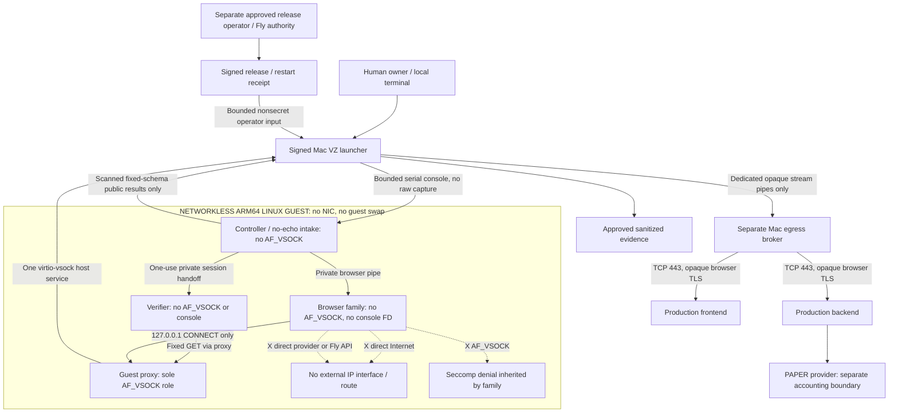

# Production acceptance controller design

Design revision: 2026-09-30. Repository baseline: `916d2ade0ca83e6d7c21fb9d81caa52c88e16fbe`, branch `codex/hosted-acceptance-tooling`, worktree `/private/tmp/day-trader-standin-exit`. Starting document SHA-256: `ca5e9d219a205ea2add29a6ba76967e987b200133cd7a8ab57846e0acf994d93`.

**Design disposition: PRODUCTION_ACCEPTANCE_CONTROLLER_DESIGN_READY_FOR_APPROVAL. B1 ARCHITECTURALLY CLOSED following fresh independent read-only review.** Selected architecture: **local Mac + Apple Virtualization.framework networkless ARM64 Linux guest + virtio-vsock egress broker**. The native Mac browser recommendation is superseded. Sections 6–9 specify the independent enforcement mechanism; section 25 records the twelve B1 closure criteria and review disposition.

Architectural closure means a credible independent enforcement mechanism is specified and has survived the written-design review. It does not mean a VM, launcher, broker, seccomp policy or controller exists or has passed qualification. Production remains paused. This revision is read-only research and editing of this existing document only; no implementation plan, dependency installation, VM/browser launch, Docker/CodeLift interaction, production request or real credential use is authorized.

## 1. Purpose

Design a narrowly controlled observational acceptance session against the exact deployed frontend and backend: normal owner UI login; exact owner binding; maintenance readiness; Robo Trader, Portfolio, and Activity rendering; protected database invariance; continuity of the same browser session across a separately approved backend restart; actual UI logout and server revocation; bounded external reads; sanitized evidence; and private-state cleanup.

The controller exposes no trade, cancel, close, reconcile, configure, enable, schedule, email, deployment, or rollback operation. A real owner session nevertheless has broader server authority than this controller's allowed commands. Route enforcement is therefore a security boundary, not merely a test convenience. This proposal does not claim that possession of the normal owner cookie is an intrinsically read-only capability.

## 2. Current verified baseline

| Item | Evidence and scope |
| --- | --- |
| Repository | `muckele/day-trader` |
| Application candidate / protected owner ref | `852fb22d9facf4bfe0bca7f419e22ee4bfbba17f` |
| Qualified tooling | `916d2ade0ca83e6d7c21fb9d81caa52c88e16fbe` |
| Hosted run | [36805206998](https://github.com/muckele/day-trader/actions/runs/36805206998), `HOSTED_TOOLING_PILOT_VERIFIED` |
| Source comparison for this design | Read-only `git diff` between the application candidate and tooling HEAD showed no backend/frontend changes. |
| Historical success | Startup and fresh restart token; Chromium sandbox; verified synthetic TLS and gateway; SP01–SP10; private one-use synthetic credentials; real UI login; exact synthetic owner; Home denials; authenticated market status; all readiness-v2 checks; three views; DB invariance; same-session restart; logout/revocation; provider accounting and uncertainty; gateway durability/outage; leakage; normal finalization and exit 0; cleanup. |
| Provenance limitation | Test-only reconstructed images. Qualified artifact tzdata `2026b`; reconstruction `2026c`. No byte-identical production image qualification or inherited exact-image security verdict. |
| Not established | Real owner login, current production state, published/deployed immutable image identity, production controller qualification, approved Mac crash storage, soak, activation, or deployment acceptance. |

The retained local milestone report is [final-report.md](/Users/Matt/.codex/visualizations/2026/09/23/01a0d016-20be-7791-a972-ef380f45a070/drop-response-permission-milestone/final-report.md). It was read, not regenerated. The run was not rerun or queried against production for this task.

The original checkout remains at `8f81a74bc44db4578164ada4928bd61cf849641c`, branch `codex/owner-paper-mvp`, `/Users/Matt/Projects/day-trader`. Its pre-existing untracked `docs/Day_Trader_Agentic_MVP_Master_Brief.md` is outside this change and remains untouched.

Source basis, all at the qualified tooling HEAD unless otherwise stated:

- [Hosted policy](../tooling/hosted-acceptance/tools/policy.cjs), [entry policy](../tooling/hosted-acceptance/tools/entry-policy.cjs), and [browser controller](../tooling/hosted-acceptance/tools/browser.cjs).
- [API mounting and owner response](../backend/server.js), [authentication](../backend/routes/auth.js), [readiness implementation](../backend/services/runtimeReadiness.js), and [readiness contract](startup-readiness.md).
- [Robo routes](../backend/routes/robotrader.js), [settings helper](../backend/robotrader/settingsService.js), [PAPER routes](../backend/routes/paperTrades.js), [portfolio adapter](../backend/services/alpacaPortfolioService.js), [adapter selection](../backend/paper/paperBrokerClient.js), [broker transport](../backend/robotrader/alpacaBroker.js), and [market status](../backend/services/executionMarketStatus.js).
- Frontend [Login](../frontend/src/pages/Login.js), [AuthContext](../frontend/src/context/AuthContext.js), [Home](../frontend/src/pages/Home.js), [RoboTrader](../frontend/src/pages/RoboTrader.js), [Portfolio](../frontend/src/pages/Portfolio.js), [Activity](../frontend/src/pages/Activity.js), [notifications](../frontend/src/components/NotificationStatusPanel.js), and [market timer](../frontend/src/hooks/useMarketStatus.js).
- [Read-only protection preflight building block](../backend/scripts/read-only-release-preflight.js), [scheduler](../backend/services/roboScheduler.js), and [runbook](mvp-runbook.md). Historical runbook statements are not current deployment facts.

## 3. Non-goals and authority limits

No implementation, implementation plan, Swift project, entitlement file, VM image, seccomp profile, proxy/broker/controller, tests, dependencies, lockfile/workflow/application changes, image publication, production revalidation, real credentials, provider/SMTP calls, Mongo access, Fly mutation, rollback, soak or activation in this milestone. Section 24 contains deliverables and review gates only, with no commands or file-level plan.

Zero Docker commands on the Mac, including inspection. No CodeLift or Docker Desktop interaction, shared Docker VM, network or volume. No pf, VPN, hosts-file, root firewall, system proxy, trust-store or global crash-reporter change. The host launcher/broker are ordinary signed user-space processes using Apple's framework, independent of Docker. The required virtualization entitlement and later signing/build steps need explicit approval; no entitlement availability or installation is presumed. Guest-only privileged initialization is part of the future immutable appliance, not Mac root authority.

The guest/controller receives no Fly/org/deployment token, production Mongo credential, Alpaca/provider credential, SMTP credential, forwarded SSH agent or inherited operational secret. No import of project `.env`, host home, clipboard, personal browser profile or general shared filesystem. A separate release authority supplies bounded signed release/restart receipts. It receives no owner password/session. No automatic release or recovery action exists.

## 4. Threat model

For B1, assume the webpage and even the browser process family may be hostile, while the approved macOS/hypervisor, guest kernel/bootstrap, controller, guest proxy, host launcher/broker and their confinement policy are trusted. Browser input/DOM/protocol output, receipts, filenames and response data remain untrusted. The B1 argument concerns removal of alternative network-capable paths; it is not a claim that a compromised browser cannot misuse a permitted opaque tunnel or encode information into approved outputs.

| Threat | Required boundary | Residual or failure handling |
| --- | --- | --- |
| Native direct TCP/UDP/DNS from browser or verifier | No virtual NIC or other packet device, guest loopback only; guest has no external route | Guest kernel/hypervisor compromise is outside the enforcement assumption. Ordinary direct Internet authority is prevented, not accepted as a residual. |
| Direct vsock or helper escape | Native ARM64 seccomp before role execution, inherited across children; no bridge FDs; role separation | Filter/launcher bug must fail synthetic qualification; seccomp is one control, not a complete sandbox. |
| FD theft, Unix relay or console bypass | Separate guest UIDs, restricted PID/mount views and device access, no host shares, no generic guest services; browser has no console FD | Browser IPC data cannot be blindly copied to host terminal/evidence or interpreted as commands. |
| Host broker compromise | Broker has only exact-destination transport and no plaintext owner/session; TLS terminates in browser/server | Broker retains ordinary host socket authority. Trusted broker compromise breaks destination confinement; TLS limits plaintext exposure but does not prevent denial/timing attacks. |
| Host launcher/host malware compromise | Small reviewed launcher, no logging of terminal input, scoped channels | Launcher necessarily forwards password bytes; same-user malware or compromised host/kernel can observe them or VM memory. Explicit residual. |
| Same-host forbidden route | Exact phase-aware Playwright gate, source-bound asset manifest and no economic commands | CONNECT/vsock cannot inspect HTTPS paths. A corrupt browser or route-policy bug can misuse owner authority through an allowed destination; the VM does not make its cookie read-only. |
| Password/history/artifact disclosure | Local no-echo terminal and guest TTY, one-use input; no argv/env/files/cloud; no raw console capture | High-level memory copies, terminal recording, host swap and diagnostics remain residual risks. |
| Guest profile or crash persistence | Read-only base attachment, guest tmpfs for all writable run state, no guest swap, no VM save/restore | Eliminates intentional guest disk persistence; does not eliminate host swap, memory remnants, OS diagnostics or physical-media residue. |
| Malicious appliance or runtime | Immutable hashes/signatures for whole appliance, kernel and all security-critical binaries/policies | Supply-chain compromise and browser/runtime/kernel exploits remain residual risks; no automatic downloads in a run. |
| Wrong release/replayed restart receipt | Independent pinned signer, exact release/nonce/action/time binding and one consume | Authorized signer compromise/dishonesty remains a trust assumption; current production facts stay unknown until approved preflight. |
| Provider overrun / economic or DB mutation | Source-bound reservations within durable full-run allowance, exclusive maintenance window, independent evidence where available | Controller does not control unrelated backend egress; unexpected activity fails acceptance and remains charged. |
| Account data or raw diagnostics exported | Fixed-schema console evidence after private checks; host parses bounded frames without terminal control sequences | Approved counts/timings leak limited activity; no complete covert-channel/noninterference claim. |
| Crash, host sleep or cleanup interruption | Full run envelope already charged outside VM; safe finalization and VM teardown; no resume | Unconfirmed logout/exit/deletion is reported as incomplete, never repaired automatically. |

The mechanism in section 9 survived fresh independent review; the verdict and assumptions are recorded in section 25. Proposed residual risks still require Mathew's explicit acceptance; none is accepted merely by writing this document.

## 5. Alternatives considered

| Venue | Credentials and persistence | Containment | Usability, auditability and cleanup | Complexity / decision |
| --- | --- | --- | --- | --- |
| Native Mac browser + CONNECT | Natural local TTY; disk-backed temporary browser state and host swap | Proxy/Playwright do not remove direct socket authority | Simple local interaction, but cannot satisfy the previous B1 argument | Rejected for B1 under the prohibited-host-change constraints. |
| **Local networkless Linux VM + vsock (selected)** | Password stays on the local Mac/guest path; no cloud transmission or credential store; guest tmpfs with no guest swap | No virtual NIC; kernel-enforced denial of browser/controller vsock; one finite proxy/broker path | Local terminal; signed receipts; fixed-schema export; destroy guest memory and validate owned resources | More appliance/launcher work, but supplies the missing independent boundary without Docker, MITM or persistent host networking changes. |
| GitHub-hosted runner | No natural owner TTY; new live private delivery needed; Actions inputs/secrets are rejected for password | Linux isolation possible but not inherited from synthetic TLS gateway | Strong job records, extra credential and restart ceremony, third-party cleanup trust | Not selected for real owner credentials. |
| Dedicated ephemeral remote Linux host | Private SSH intake possible, but password/session necessarily enter remote memory | Conventional isolated namespaces/VM networking possible | Host-key, admin, cloud, snapshot and teardown trust; more operator channels | Could confine networking, but local VM avoids the additional remote credential boundary. |

The local VM is selected because it replaces a missing native enforcement primitive with an explicit absent-device boundary and constrained non-IP bridge. Exact implementation still needs qualification. No VM was created to make this comparison.

| Storage alternative | Decision |
| --- | --- |
| Previous Mac encrypted disk-backed temporary profile | Superseded; no intentional browser/profile file writes on the Mac in the selected architecture. Host swap/diagnostics still may persist secret-bearing pages. |
| Native Mac RAM disk | Not selected; mounting/privilege/lifecycle questions add complexity and do not remove host swap or diagnostics. |
| Read-only guest base + guest tmpfs, no guest swap | Selected. Limits writable run state to guest memory-backed filesystems; fixed tmpfs limits are real guest filesystem bounds, not a guarantee about host physical RAM. |
| Remote RAM-backed appliance | Similar guest controls with additional third-party host/hypervisor trust; not selected. |

Playwright-only interception is still insufficient. Opaque CONNECT plus topology/vsock enforcement is selected; production TLS interception remains prohibited.

## 6. Selected architecture and authoritative platform findings

### 6.1 Concrete roles and runtime

Host: Mathew's Apple Silicon Mac, with a small native Swift launcher using public Virtualization.framework APIs and a separate normal-user egress broker process. The launcher owns VM lifecycle, the bounded console and the framework's vsock listener. It relays accepted vsock streams over dedicated private pipes to the broker; those pipes carry the bounded destination protocol and opaque TLS, never console input. The broker receives no terminal, credential, DOM or browser-protocol handle. No listening host TCP administration service is needed.

Guest: an immutable ARM64 Ubuntu 24.04-compatible minimal Linux appliance, pinned Node.js/Python, official Playwright and its native Linux ARM64 Chromium. Run the full bundled Chromium in headless mode with its sandbox enabled; no `--no-sandbox`, no host graphical display/clipboard and no personal profile. The qualified hosted build is evidence about earlier tooling only, not this appliance.

Use four distinct unprivileged guest role UIDs: controller/intake, browser family, revocation verifier, and egress proxy. Trusted guest bootstrap establishes their credentials, capabilities, filesystem/PID isolation, seccomp and finite IPC before owner input. It provides a fixed browser-start/pipe handoff for the pinned executable; it accepts no arbitrary shell/argv/path request. No credential may be entered until all roles are non-root with empty inherited/permitted/effective/ambient capabilities in the initial guest user namespace. Browser-owned files have a browser-UID scanner; controller-owned evidence has a controller-UID scanner. Do not recreate root-owned unreadable artifacts or widen modes to combine roles.

### 6.2 Zero network devices is supported

Apple defines `VZVirtualMachineConfiguration.networkDevices` as the network devices exposed to the guest and documents its default as an empty array. The selected configuration explicitly sets/attests an empty list and never constructs a network attachment. Apple's minimal Linux sample supplies boot parameters and a serial console without adding a NIC. These support a Linux VM with **zero VZNetworkDeviceConfiguration objects**, not merely an unconfigured guest NIC. [Apple networkDevices](https://developer.apple.com/documentation/virtualization/vzvirtualmachineconfiguration/networkdevices), [Apple Linux sample](https://developer.apple.com/documentation/virtualization/running-linux-in-a-virtual-machine).

Corroborating authoritative local source read for this revision: [Apple SDK VZVirtualMachineConfiguration.h](/Library/Developer/CommandLineTools/SDKs/MacOSX26.5.sdk/System/Library/Frameworks/Virtualization.framework/Versions/A/Headers/VZVirtualMachineConfiguration.h). It describes network adapters as empty by default and devices/attachments as explicit choices. **Architectural inference:** with no NIC, no USB/custom network device, no shared packet transport and a trusted hypervisor, the guest cannot emit IP packets onto the host LAN/Internet. Apple does not automatically supply a NAT/bridged NIC in the documented configuration. Actual empty configuration/runtime device lists and guest interfaces/routes must later be attested; they were not observed in a running VM here.

Only these devices are admitted: Linux boot loader, read-only base block attachment, entropy, one virtio serial console, and one virtio socket device. All network, directory sharing, USB controllers, audio, graphics, keyboard/pointing, balloon and additional/custom devices are absent. No NAT, bridge, vmnet, VPN, packet relay, cloud-init agent or DHCP/DNS guest service. Unknown device/service means admission failure.

### 6.3 Virtio socket mechanism

Apple's `VZVirtioSocketDeviceConfiguration` creates one guest/host socket device; the SDK explicitly describes `VZVirtioSocketDevice` transfer without Ethernet or IP. A single socket device may be configured per VM. At runtime the launcher obtains it from `VZVirtualMachine.socketDevices`, registers one `VZVirtioSocketListener` via `setSocketListener(_:forPort:)`, and accepts/rejects connections through its delegate. `VZVirtioSocketConnection.fileDescriptor` is an owned stream descriptor whose lifetime must be retained/closed correctly. [Apple socket device](https://developer.apple.com/documentation/virtualization/vzvirtiosocketdevice), [SDK device](/Library/Developer/CommandLineTools/SDKs/MacOSX26.5.sdk/System/Library/Frameworks/Virtualization.framework/Versions/A/Headers/VZVirtioSocketDevice.h), [SDK configuration](/Library/Developer/CommandLineTools/SDKs/MacOSX26.5.sdk/System/Library/Frameworks/Virtualization.framework/Versions/A/Headers/VZVirtioSocketDeviceConfiguration.h), [SDK connection](/Library/Developer/CommandLineTools/SDKs/MacOSX26.5.sdk/System/Library/Frameworks/Virtualization.framework/Versions/A/Headers/VZVirtioSocketConnection.h).

Guest proxy uses native Linux AF_VSOCK/SOCK_STREAM, destination `VMADDR_CID_HOST` (CID 2), one fixed nonprivileged service port (design value 4050). CID and port identify endpoint/service; they are not IP addresses. No guest vsock listener, datagram relay, arbitrary CID/port, host-initiated guest service or other host listener is permitted. Kernel prerequisites include CONFIG_VSOCKETS, CONFIG_VIRTIO and CONFIG_VIRTIO_VSOCKETS with the virtio transport available before admission. These capabilities are independent of IP networking. [Linux vsock ABI](https://man7.org/linux/man-pages/man7/vsock.7.html), [upstream kernel Kconfig](https://github.com/torvalds/linux/blob/master/net/vmw_vsock/Kconfig).

The only guest role with usable AF_VSOCK is the proxy; its code only connects to the fixed host service. Seccomp cannot safely inspect the pointed-to sockaddr in `connect()`, so fixed CID/port enforcement is a trusted proxy-code contract plus the single host listener, not a fictional seccomp address check. The host binds the channel to this VZ instance, a run ID and one-use run capability supplied during trusted bootstrap, with no owner secret. There is no vsock credential/evidence/admin service.

### 6.4 ARM64 browser choice

Select official **Playwright-distributed Linux ARM64 Chromium** on Ubuntu 24.04 ARM64, paired with the same pinned Playwright release. Official Playwright supports that OS/architecture; its versioned 1.58.2 registry explicitly maps Ubuntu 24.04 ARM64 to `chromium-linux-arm64.zip`, separate from the x86 Chrome-for-Testing path. This establishes a viable official distribution path without downloading a binary. Exact approved versions/hashes and sandbox compatibility are later appliance gates, not invented here. [Playwright requirements](https://playwright.dev/docs/intro), [official versioned registry](https://github.com/microsoft/playwright/blob/v1.58.2/packages/playwright-core/src/server/registry/index.ts), [paired browser metadata](https://github.com/microsoft/playwright/blob/v1.58.2/packages/playwright-core/browsers.json).

Do not assume the hosted Chrome-for-Testing 145 artifact has a Linux ARM64 counterpart. Current CfT documentation now lists Linux ARM64 support beginning at 153.0.8001.0; that does not backfill older versions or qualify a new version. [Official CfT platforms](https://github.com/GoogleChromeLabs/chrome-for-testing#supported-platforms). Native Playwright Chromium avoids translation. Rosetta/Intel translation is therefore not selected and no Rosetta directory share, binfmt interpreter or extra executable ABI is included. Apple's supported translation path exists but adds unnecessary surface here. [Apple Intel binaries in Linux VMs](https://developer.apple.com/documentation/virtualization/running-intel-binaries-in-linux-vms).

### 6.5 Host authority and provenance

Creating a VZ VM requires the **com.apple.security.virtualization** entitlement in the launcher's signed executable; missing entitlement makes configuration invalid. Apple's instructions place this in Signing & Capabilities and explicitly allow removal of the separate App Sandbox entitlement when not otherwise needed. Entitlement/signing is an explicit later build/approval requirement; this task neither creates it nor assumes a usable signing identity is already configured. [Apple entitlement setup](https://developer.apple.com/documentation/virtualization/adding-the-virtualization-entitlement-to-your-project), [SDK configuration](/Library/Developer/CommandLineTools/SDKs/MacOSX26.5.sdk/System/Library/Frameworks/Virtualization.framework/Versions/A/Headers/VZVirtualMachineConfiguration.h).

The selected APIs are a normal application/command-line framework path, not a root helper or installed system extension. Apple's documented Terminal/Xcode sample and entitlement procedure support that path; **the design inference is that no privileged persistent host networking change is needed because no networking device/attachment is created**. No vmnet/networking/device-access entitlement, bridge, pf or third-party hypervisor extension is part of this design. Host-specific signing/Gatekeeper/entitlement validation and resource availability remain execution gates; any request for administrator authority, privileged helper or new persistent system change stops for design review and explicit approval. We do not claim every distribution/signing method is available without user approval. [Apple Linux sample](https://developer.apple.com/documentation/virtualization/running-linux-in-a-virtual-machine), [Apple user-space hypervisor model](https://developer.apple.com/documentation/hypervisor).

The future appliance manifest binds base-image bytes, kernel/initramfs and kernel configuration, guest bootstrap/role policy, controller, proxy, Node/Python, Playwright/browser, host launcher/broker, VM device configuration and macOS/SDK compatibility. Record cryptographic hashes and reviewable source/build provenance, with a signed manifest verified before boot. Hashes are identities, not security verdicts. No package/browser installation, mutable downloads or image rebuilding during a real run. The base must contain no credential; all run-specific input arrives through the bounded local console.

## 7. Trust boundaries

The diagram is the architecture selected for later qualification, **not observed runtime behavior**.

There is no general shared filesystem, SSH agent, host Unix socket, clipboard, vsock admin endpoint or direct browser-to-console edge. The serial channel is a deliberately narrow **operator/data** channel controlled by trusted controller/launcher code, not a network relay. It accepts fixed configuration/approval/receipt frames and one credential consume, and exports only the separate fixed public schema. Never interpret guest text as a shell command, URL to fetch, terminal escape sequence or host file path.

The launcher necessarily carries private terminal bytes in memory; the separate egress broker never receives those bytes. The broker sees destination enum/host, connection timing and counts, plus encrypted TLS bytes. Guest/controller has no Fly/DB/provider/SMTP secret. Release authority has no password/session. Endpoint identity and HTTP route policy remain separate from network topology.

## 8. Credential lifecycle and exact owner binding

Before prompting, validate the release envelope, expected owner/destinations, appliance identity, device/route invariants, seccomp/FD/role attestation, storage/scanner admission and durable read allowance. All local synthetic qualification must already have passed. No prompt if any invariant fails or an unapproved service/device appears.

Supported path: **Mac controlling terminal → launcher's nonlogging file-handle serial attachment → guest virtio console TTY → controller's one-use no-echo intake → actual browser Password field**. Apple supplies `VZVirtioConsoleDeviceSerialPortConfiguration` and `VZFileHandleSerialPortAttachment`, including a Linux sample that disables local echo/canonicalization before forwarding stdin. Use those APIs with anonymous pipe-backed handles so the launcher can enforce bounded phases instead of attaching an uncontrolled raw guest log to stdout. No `VZFileSerialPortAttachment`, recording console file or remote input service. [Apple serial sample](https://developer.apple.com/documentation/virtualization/running-linux-in-a-virtual-machine), [SDK serial attachment](/Library/Developer/CommandLineTools/SDKs/MacOSX26.5.sdk/System/Library/Frameworks/Virtualization.framework/Versions/A/Headers/VZFileHandleSerialPortAttachment.h).

Host and guest independently verify a real TTY and disable echo during input; restoring only guest echo is insufficient because host terminal processing is separate. Restore both terminal modes on success, timeout, cancellation and handled signals. Host input buffers are bounded and discarded after forwarding; no transcript captures input. Guest device ownership grants console access only to controller/intake, with no shell/getty/login service. Browser starts in a separate session with no controlling TTY, console/device FD, console pathname access or controller UID. It receives only reviewed browser pipes; its stdout/stderr are privately bounded or discarded, never forwarded raw to the host. Linux termios provides the ECHO control; exact dual-TTY handling remains a synthetic qualification gate. [Linux termios](https://man7.org/linux/man-pages/man3/termios.3.html).

Reject redirected stdin, unattended/recording input, wrong run/destination/consumer, stale or duplicate consume, oversized input and timeout (120 seconds). A capability-bound private guest pipe binds intake to this controller/browser and approved frontend/backend. Set UNUSED→CONSUMED atomically before filling the normal Password field. Fill Username/Password, discard controller/intake references immediately after fill acknowledgment, and click **Log In** once. Browser/form memory necessarily retains the value through normal submission and then unmounts. No retry, direct login POST substitute, JWT/cookie injection, storageState import or second credential entry.

No owner password in argv, environment, config, filesystem, GH input/secret, clipboard, cloud, shell history, log, screenshot/trace/video/HAR, evidence or vsock service. The Mac launcher necessarily sees bytes while forwarding; it must not intentionally record them. High-level strings, serialization, browser/React state, host/guest memory and garbage collection prevent guaranteed physical zeroization. Reference discard limits lifetime, not physical remnants. No secure-memory-erasure claim.

Expected owner is a private exact server ID or domain-separated fingerprint supplied through the bounded local operator channel and bound to the signed release/environment. Do not infer it from username. Private `/api/me.user.id` must match exactly. Public output is only `ownerExactMatch=true`; never ID, username, email, fingerprint, JWT or body. A mismatch terminates before deeper observation.

Do not retain plaintext password for final leakage scans. Bounded run-keyed one-way detectors/lengths of approved representations may be formed during intake and retained only in guest memory for the private scanner. This mechanism must be qualified with synthetic secrets; it cannot detect every encoding or host artifact. Destroy detector state at finalization. No intentional detector/session serialization even though browser support state uses tmpfs.

## 9. Network containment, vsock confinement and TLS

### 9.1 Independent B1 enforcement chain

1. The launcher's explicit VZ device list contains **no network device**, NAT/bridge/vmnet attachment, USB/custom packet device or host share. The trusted hypervisor exposes no guest IP connection to host/LAN/Internet (section 6.2).
2. The immutable guest admits only loopback, with no Ethernet interface, IPv4/IPv6 default route, tunnel/VPN, packet relay or external DNS service. Unexpected interface/route/listener fails admission; creating a software route without an external device cannot provide an external packet path.
3. A native ARM64 seccomp filter denies AF_VSOCK creation in controller, verifier and every browser/helper process before any untrusted work. It does not deny all AF_INET/AF_INET6 calls: the browser needs guest loopback.
4. No vsock, host-network, console or arbitrary bridge FD enters the browser family. Controller has only the explicitly bounded console channel and never a vsock/network bridge FD. Role isolation blocks theft or IPC transfer of proxy/console capabilities (section 9.2).
5. The sole useful guest IP listener is `127.0.0.1` guest CONNECT proxy, with finite destination policy. No generic loopback service can relay traffic.
6. Only the trusted proxy may create AF_VSOCK, and its code targets one fixed host service. Only that service is registered for this VM. Host broker independently maps a fixed destination enum to two release-bound HTTPS endpoints.
7. The broker resolves/validates an approved address and opens only TCP 443. It relays opaque bytes; browser verifies the real public TLS chain and hostname.
8. The separate trusted controller route gate checks intended origin, method, path, query and phase; it never infers an HTTP route from a tunnel.

**Architectural conclusion accepted by the independent review:** under these trusted-platform/component assumptions, browser/controller direct external IP traffic is unavailable, and browser/verifier cannot acquire the non-IP vsock/console alternatives. Proxy flags improve predictable browser behavior; absent NIC plus kernel-enforced role restrictions provide the independent boundary. Finite tests verify an implementation of this chain; tests are not its architectural basis.

### 9.2 Seccomp, process family and descriptor isolation

Linux seccomp BPF can inspect syscall number, architecture and scalar arguments; `socket()`'s domain is a scalar argument, so denying AF_VSOCK is supported. Filters persist across permitted fork/clone/exec and can only be tightened; no_new_privs prevents exec-based privilege gain. Install in a single-threaded trusted role launcher before runtime startup; if any existing threads must be covered, require successful thread synchronization and fail on an unsynchronized thread. All browser parent/renderers/GPU/network service/crash helpers, Playwright-spawned children, controller helpers and verifier inherit the outer policy regardless of Chromium's additional sandbox. [Kernel seccomp](https://docs.kernel.org/userspace-api/seccomp_filter.html), [seccomp ABI including TSYNC](https://man7.org/linux/man-pages/man2/seccomp.2.html), [no_new_privs](https://docs.kernel.org/userspace-api/no_new_privs.html).

The design policy permits only the native AArch64 syscall ABI and fails closed on other audit architectures; no 32-bit compatibility, alternate ABI, Rosetta or binfmt interpreter is admitted. Socket/socketpair domain policy is a small allowlist: AF_UNIX, AF_INET and AF_INET6; any narrowly needed AF_NETLINK query behavior must be justified without initial-namespace CAP_NET_ADMIN. AF_VSOCK, AF_PACKET, raw sockets and unknown domains are denied. Do not pretend filtering `connect()`'s pointer proves a destination restriction. Kernel seccomp documentation explicitly warns that pointer targets are not inspected and seccomp alone is not a sandbox.

Deny `io_uring_setup`, `io_uring_register` and `io_uring_enter`, and inherit no ring FD: io_uring has its own socket-creation operation, so a rule on `socket()` alone is insufficient. Likewise deny ptrace, cross-role process_vm access and `pidfd_getfd`; do not use seccomp TRACE/USER_NOTIF to grant exceptions. The exact full syscall policy is a future reviewed artifact, not included here. Compatibility failure must be fixed without removing the required restrictions or disabling Chromium's sandbox. [io_uring socket API](https://man7.org/linux/man-pages/man3/io_uring_prep_socket.3.html), [pidfd_getfd](https://man7.org/linux/man-pages/man2/pidfd_getfd.2.html).

Trusted guest bootstrap creates separate role UIDs and restricted browser and verifier PID/mount views. Neither role's `/proc` can expose controller/proxy/supervisor processes or descriptors; no access to their private 0700 directories or console/vsock device nodes. Empty initial-namespace capability sets prevent raw-packet, network-device or cross-role privilege operations. Chromium may create additional restricted user/PID namespaces for its own sandbox; these cannot add a hypervisor NIC, remove inherited seccomp, obtain ancestor privileges or expose host files. No setuid helper may gain privilege after no_new_privs. [PID namespaces](https://man7.org/linux/man-pages/man7/pid_namespaces.7.html), [mount namespaces](https://man7.org/linux/man-pages/man7/mount_namespaces.7.html), [capabilities](https://man7.org/linux/man-pages/man7/capabilities.7.html).

Before each role exec, explicitly close every descriptor except its role's audited pipe/TTY/null handles, with close-on-exec default on new descriptors. Browser and verifier get no TTY, serial/vsock/ring FD or inherited socket connected outside their role; a browser automation pipe only connects to the trusted guest controller. Proxy gets no console/evidence or credential handle. Verify the allowlisted descriptor inventory and `/proc`/device restrictions before credentials and through child-creation tests. [close_range](https://man7.org/linux/man-pages/man2/close_range.2.html), [proc FD access rules](https://man7.org/linux/man-pages/man5/proc_pid_fd.5.html).

AF_UNIX is guest-local, not automatically harmless: it can transfer descriptors through SCM_RIGHTS and abstract sockets ignore filesystem modes. Therefore there is no generic guest FD broker, SSH/dbus/system agent, shared host socket, or proxy IPC endpoint handing out vsock FDs. Trusted role channels authenticate peers, use fixed messages and reject ancillary FD transfers except the pre-arranged browser-pipe bootstrap handled before untrusted execution. Existing Chromium-internal FD passing stays within the confined family and cannot create a bridge that no participant holds. No untrusted browser request can ask a privileged supervisor to launch an arbitrary program or return a privileged FD. [Linux Unix sockets](https://man7.org/linux/man-pages/man7/unix.7.html).

### 9.3 Guest proxy, host broker and DNS

Destination hints from repository remain `https://day-trader-frontend.fly.dev` and `https://day-trader-backend.fly.dev`. Their current ownership/routing/release identity is **unknown** until separately approved read-only preflight; no production request occurs in this task. Both proxy and broker consume the same authenticated release envelope, with exactly two ASCII hostnames and port 443. No wildcard/suffix/IP-literal/trailing-dot/userinfo or arbitrary URL/DNS input.

Guest proxy listens only on `127.0.0.1` at one approved fixed port, with a private run capability and bounded CONNECT headers. IPv6 loopback listening is not selected. Only CONNECT for the exact approved host:443 passes; reject ordinary HTTP, SOCKS, UDP, CONNECT-UDP, alternate protocol/host/port and malformed/duplicate targets. Translate to a fixed binary/schema request: protocol version, run binding, sequence and destination enum FRONTEND or BACKEND; port is implicit 443. At most 256 bytes of control header, 16 simultaneous tunnels, bounded idle/run lifetime, and a manifest-approved aggregate byte ceiling. No arbitrary target string, credential/body logging or general command message. Limits must be tested and approved before execution, not widened dynamically.

One vsock stream represents one tunnel. The host launcher accepts only the registered VM/service and privately forwards that stream to the separate broker through dedicated bounded pipes. The broker repeats version/run/sequence/destination/limit validation. It never handles console bytes, owner IDs, authentication headers, HTTP bodies, DOM or decrypted response data. It uses normal Mac TCP/DNS facilities, requires no TLS certificate/key and performs no TLS termination. Host stream/capability loss latches FAILED; reconnect/restart never resumes acceptance.

Only the broker resolves the two mapped hostnames through the approved host system resolver. Validate all selected IPv4/IPv6 results against non-public classes, including loopback/private/link-local/unspecified/multicast/reserved/documentation and IPv4-mapped or translated representations of forbidden addresses. Recheck on each new connection and connect to the already validated numeric address without a second lookup. A CNAME does not create another allowed input or bypass address validation. Do not pin stale Fly IPs, accept caller DNS packets, run a guest resolver relay or forward arbitrary labels. Address classification and DNS rebinding cases are future property tests.

The guest has no external DNS path; Chromium's HTTP proxy protocol carries the target hostname for proxy-side resolution. Fixed proxy, no PAC/system/DIRECT fallback and removal of implicit localhost bypass remain required configuration, but failed DNS/direct attempts are ultimately contained by topology. [Chromium proxy design](https://chromium.googlesource.com/chromium/src/+/HEAD/net/docs/proxy.md).

### 9.4 TLS, intended origin and hostile-browser limits

End-to-end browser/server TLS remains mandatory: public CA trust, hostname/SNI verification, `ignoreHTTPSErrors=false`, no custom CA, TLS MITM, plaintext substitute or certificate bypass. Neither proxy nor broker terminates TLS. TLS negative tests use owned synthetic fixtures, never a production trust override.

CONNECT identifies a requested network destination, not the encrypted HTTP authority/path. HTTP/2 reuse/coalescing and overlapping certificate SANs can reuse an allowed connection for a different intended origin. Independently validate each Playwright request's origin/route, prevent unapproved redirects/secondary origins, and verify exact asset/release identity. The broker connects only to an address resolved for the selected approved hostname, but does not attest SNI/HTTP Host inside the opaque tunnel. A browser compromised below interception/TLS can send arbitrary encrypted bytes through an allowed tunnel; this does not create a second egress path, but it can defeat application-level promises. B1 is path confinement, not a guarantee of read-only owner authority or virtual-host identity against a compromised browser. The controller/browser runtime remains trusted for correct auth/TLS/UI results; residual exploit risk is explicit.

### 9.5 Attack-path analysis and required future synthetic evidence

All tests below use owned fixtures without real credentials, only after explicit execution approval. A negative test must show the attempted operation occurred and the owned receiver saw no forbidden delivery; a missing fixture or cache hit is not a pass.

| Attempt / surface | Enforcement and external-traffic result | Required synthetic test |
| --- | --- | --- |
| Public IPv4 TCP | No NIC/external route; direct connect cannot deliver outside guest | Direct connect from browser, controller and verifier with interception removed; receiver count zero. |
| Public IPv6 TCP | Same absent-device boundary; no IPv6 default route | Global IPv6 canary and route/interface inventory; no delivery. |
| UDP, QUIC/HTTP3 | No external packet path; proxy supports streams only; QUIC also disabled | External datagrams/HTTP3 attempts; broker must never receive a UDP command. |
| WebRTC | No nonproxy UDP/IP route; disable WebRTC/non-proxied UDP as additional configuration | STUN/TURN/ICE to owned IPv4/IPv6 fixture; zero direct delivery, no arbitrary proxy target. |
| Direct/alternate DNS | No external UDP/TCP path, no guest DNS relay | UDP/TCP 53 to multiple owned addresses fails; broker rejects arbitrary DNS input. |
| Direct DoH | No direct HTTPS path; DNS-provider CONNECT host rejected | Direct and proxied DoH target attempts denied; no new clock/provider activity. |
| IP literal / alternate hostname or port | Proxy and broker exact destination enum/443 contract | Parser/property cases including encodings, suffixes, duplicate headers, IPv6 and mapped addresses. |
| Multicast / link-local | No physical/virtual NIC, no external link; host broker rejects class | mDNS, link-local IPv4/IPv6 and metadata-address fixtures fail. |
| Guest localhost | Only approved proxy is useful; loopback is not host LAN or Internet | Approved proxy positive test; every unexpected TCP/UDP listener, including ::1, fails admission. Host loopback is a different stack. |
| AF_VSOCK | Browser/controller/verifier socket/socketpair denied before syscall; no inherited descriptor | Native calls from every role and newly forked/execed helper fail; proxy-only positive to fixed host port. |
| io_uring / alternate ABI | Ring syscalls/FDs and non-AArch64 ABI denied | Attempt socket via io_uring, alternate syscall entry and inherited-ring tricks; no bypass. |
| AF_UNIX / SCM_RIGHTS / /proc | Guest-only sockets, no external-capability donor, UID/PID/mount/FD separation | Try proxy/controller FD theft, cross-role socket access and ancillary transfer; no bridge descriptor obtained. |
| Raw sockets / AF_PACKET / netlink | Domain/type restrictions, no initial NET_RAW/NET_ADMIN, absent NIC | Packet sockets, interface/route changes and tunnel creation fail; any needed route-query behavior stays local. |
| Helper/network/GPU/crash process | Outer filter/role boundary persists across child exec; no privilege gain | Enumerate descendants, restrictions and FDs; direct/vsock probes from each representative child. |
| Extensions / service workers | None installed; service workers blocked; any child still confined | Attempt worker registration and unapproved network requests; no forwarding. |
| Popups/new windows | Reject unapproved context/page creation; same family remains confined | Hostile page popup fetch/navigation attempts, including direct-socket helper probes. |
| WebSocket / WebTransport | Application gate denies; no direct path; no generic upgrade/UDP bridge | Proxied and direct attempts denied before application delivery. |
| Console / host shares / extra devices | Browser no console FD/device/UID; no shares or other virtual transport | Attempt /dev/console/hvc, proc reopening, raw stdout, escape sequences, clipboard/fileshare paths; no uncontrolled host output/action. |
| TLS mismatch/untrusted/expired | Browser's normal TLS verification | Approved frontend/backend fixture positive; all three negative classes fail with zero authenticated handler delivery. |
| HTTP/2/coalescing/SAN overlap | Intended origin gate independent of tunnel destination | Owned shared-IP/SAN origins; no unapproved route/origin acceptance despite connection reuse. |
| Broker/proxy outage | Close listener **and existing tunnels**, latch run failure; no alternative path | Kill host broker, guest proxy and vsock transport separately; cached content is not success; neither restart resumes/retries. |

Qualification also binds configuration and runtime device inventory, interface/route tables, exact role UID/capability/seccomp/FD inventory, absence of unexpected guest listeners, broker target audit and application request counters to the immutable appliance. No claim is made that these tests already passed.

## 10. Exact phase-aware route policy

Fixed IDs below are derived from source, not conceptual endpoint names. All paths are on backend B unless marked frontend F. All queries are empty unless specified. Reject unknown/duplicate query keys, altered values, encoded path tricks, dot segments, fragments in request targets, unexpected body/headers, method overrides, unexpected Origin and non-HTTPS schemes. Compare parsed origin, raw target and canonical path consistently; do not normalize an ambiguous request into permission. Route/budget admission is atomic before continuation; a missing/throwing handler must abort.

Phase abbreviations: P = PREFLIGHT/AWAIT_CREDENTIAL; A = AUTHENTICATING; B = OBSERVE_BEFORE_RESTART; H = HOLD_FOR_RESTART; C = OBSERVE_AFTER_RESTART; L = LOGOUT; V = VERIFY_REVOCATION. No application traffic in FINALIZE, DONE or FAILED except the narrowly defined failure-cleanup logout path in section 18. Each limit below is a maximum, not an instruction to issue extra calls. Any new demand requires design review, not dynamic widening.

| Route ID | Exact method / path / query | Permitted phase and forward ceiling | Worst-case new PAPER reads per admitted attempt |
| --- | --- | --- | ---: |
| frontend-document | F GET `/login`, `/`, `/robo`, `/portfolio`, `/activity`; no query | `/login` P once; `/` A once only as normal login transition; `/robo` B/C once each; `/portfolio` and `/activity` B once each. SPA navigation need not send a document request. | 0 |
| frontend-asset:<manifest ID> | F GET exact file in immutable release asset manifest; no query | P/A/B/C/L, at most 5 per asset across the run; no arbitrary `/static/*` | 0 |
| health | GET `/health` | P 1; C 1 after authenticated restart receipt | 0 |
| me | GET `/api/me` | P 2; A 2; B 1; C 1; V 2 (one current context, one prior-session verifier) | 0 |
| login | POST `/api/login` | A exactly one attempt; bounded JSON fields username/password only | 0 |
| readiness | GET `/api/readiness` | B 2; C 2; first response must pass before any deeper route | 0 |
| market-status | GET `/api/market/status` | P 1 unauthenticated; B 1 authenticated; C 1 fresh authenticated | P 0; B/C 1 |
| settings | GET `/api/robotrader/settings` | B 1; C 1 | 0, conditional existing-settings requirement |
| decisions | GET `/api/robotrader/decisions?environment=paper&limit=25` | B 1; C 1 | 0 |
| robo-orders | GET `/api/robotrader/orders?environment=paper&limit=25` | B 1; C 1 | 0 |
| performance | GET `/api/robotrader/performance?environment=paper` | B 1; C 1 | 2: account + positions |
| audit | GET `/api/robotrader/audit?limit=25` | B 1; C 1 | 0 |
| robo-health | GET `/api/robotrader/health` | B 1; C 1 | 1: account |
| reconciliation | GET `/api/robotrader/reconciliation-status?environment=paper` | B 1; C 1 | 0 |
| portfolio-account | GET `/api/paper-trades/account` | B 1 | 2: account + positions |
| portfolio-equity | GET `/api/paper-trades/equity` | B 1 | 2: account + portfolio history |
| activity-orders | GET `/api/paper-trades/orders` | B 1 | 1: account; orders from local OrderIntent DB |
| activity-trades | GET `/api/paper-trades/trades` | B 1 | 1: account; fills from local Fill DB |
| notifications | GET `/api/robotrader/notifications` | B 1 | 0; NotificationOutbox history read only |
| logout | POST `/api/logout` | L 1; body matches deployed frontend contract | 0; intentional sessionVersion mutation |
| preflight-login / preflight-logout | OPTIONS `/api/login` or `/api/logout` | A/L respectively, at most 1 each; exact frontend Origin, requested method POST, requested header content-type where actually emitted | 0 |

Query ordering may vary as emitted by Axios; the exact key/value set above is required. Empty query delimiters, duplicates and percent-encoded alternatives are denied. HEAD is not needed by the observed UI and is denied. No generic OPTIONS, POST, PUT, PATCH, DELETE, wildcard origin, arbitrary asset or arbitrary redirect allowance. Additional CORS behavior must be explained by the immutable frontend/backend before execution; it cannot be discovered by permitting everything.

Special entry behavior is a **deny policy**, not additional forwarded routes. The actual Login navigates to Home. Within a 10-second armed transition after successful login, tolerate exactly one aborted GET `/api/recommendations` and one aborted GET `/api/watchlist/default`, both empty-query and backend-origin only, with zero downstream forwarding. Then close the transition. Any repeat, other phase, query, method or different Home request is fatal. In particular quotes/sparkline POSTs stay denied. This preserves the qualified entry lesson while keeping recommendation persistence and stock-data calls out of the flow.

The 30-second market timer must not create unreserved calls. P/A may replay the private real pre-auth 401 only while **no authenticated session has been issued and the browser remains on the `/login` document**, bounded to 32 replays across P/A. Never replay that 401 into an authenticated Home transition: [the frontend response interceptor](../frontend/src/index.js) would redirect the whole document to `/login`. Never fabricate an authenticated 200. Once the session exists, abort the timer until exact owner/readiness gates pass; do not forward or reuse the pre-auth response.

B/C permit one freshly reserved real market response in each phase after the gates pass; require valid schema, PAPER clock source, OPEN/CLOSED and recent `asOf` (within 60 seconds of a qualified local clock). Only that same response may be replayed privately while still fresh, same session and phase, bounded to 32 replays per phase. Expected **zero-forward timer denials** are explicit: A at most 2; B/C during readiness gating or after replay expiry at most 4 per phase; H at most 24 within its 10-minute deadline; L/V at most 2 per phase. Each case applies only to the exact empty-query backend GET market-status route; anything else or a counter overflow fails. These are aborts, not synthetic HTTP 401s or successful observation evidence. No unreserved retry or fresh provider call follows expiry. Accepted view/market evidence must be collected while its real market response is fresh; failure to finish within that freshness window aborts the observation, rather than treating stale data or timer errors as successful UI rendering. No accepted view proof is taken in H/L/V.

Invalidate market responses on HOLD, session change, failure and restart; C obtains new evidence. No pause of JavaScript timers may hide an unexpected economic request. These narrow timer denials keep known background work from spending reads while preserving fatal treatment of unexpected application traffic.

All HTTP 3xx responses are rejected in this initial design, including same-host redirects. The observed app's normal login uses client-side navigation, which is separately limited to the approved document paths. If a deployed origin introduces a necessary canonical redirect, revise the finite source/target/method/phase table before acceptance; do not follow it speculatively. No authenticated redirect to another origin is allowed.

Static assets: the separate release authority derives a signed finite pathname/content-hash/size/MIME manifest from the **published immutable frontend image**, including referenced JS/CSS chunks, fonts, icons and other resources. Only actual required entries are permitted. Validate document/asset bytes privately against it; no missing asset fallback, arbitrary same-origin path or remote font. Exclude source maps and the synthetic `/static/js/acceptance-missing.js` probe. Missing required assets fail. Browser routing does not provide wire-level duplicate-header/framing inspection; do not claim the hosted gateway's raw-parser tests transfer to opaque CONNECT.

## 11. Release and image binding

Admission requires a versioned, bounded, authenticated release envelope from the separate release authority: application SHA, exact frontend/backend immutable registry manifest digests and platform image digests as applicable, intended app/environment and exact origins, asset-manifest digest, a nonsecret release/configuration identity, issuance/expiry, and approved operation identifier. No secret values or hashes of secret environment variables are included; the release authority supplies same-configuration assertions.

Trust a pre-approved receipt signing public key delivered independently by Mathew, not a key included in the envelope itself. The corresponding private signing key is held only by the release authority; it grants no Fly access to the controller. Validate the canonical signed envelope, version, key fingerprint, bounded sizes, expiry and exact expected release. No latest-tag resolution in the controller.

Source match, public TLS and matching asset bytes are necessary but do not prove which backend image is running. Require independently obtained deployment observations binding the running instances to immutable digests. A self-reported backend JSON field is insufficient. Reject missing/mismatching provenance. Verify the same release again after restart. Existing documents, old image IDs, tzdata equivalence, successful hosted tooling and deprecated `releaseReady` cannot fill this gap. No immutable production identity has been freshly verified by this task.

## 12. Read-cost accounting and database invariance

Maintain separate PAPER-provider and stock-data ledgers. The initial proposed route schedule costs at most **14 new PAPER reads**: clock 2, account 8, positions 3, portfolio history 1; stock-data reads 0. This differs deliberately from the hosted 13-read schedule because C requires a fresh post-restart clock response. These are source-derived reservations for this schedule under the canonical Alpaca adapter, not a production authorization or observed usage. No historical offset or maximum is assumed; the hosted historical 6 and total 19 must not be carried into production.

Source basis: `alpacaPortfolioService` verifies the account before Portfolio/Activity reads; performance calls account and positions; health calls account; market status calls clock. The broker transport has timeout and `maxRedirects:0` and no retry loop in the inspected function. Future admission must bind all transport/interceptor/dependency behavior to the deployed digest and verify adapter configuration selects actual `alpaca-paper`, not the local simulator. Simulator reads can have different side effects and costs. A 200 with `brokerError`, disconnected PAPER health, missing data or wrong source is failure, even if HTTP succeeded.

Before any provider-bearing route is continued, atomically reserve its entire worst-case cost and record a sanitized intent in a private 0600 journal containing only fixed route ID, sequence, phase, cost and outcome. Commit the reservation in guest tmpfs before send for ordering; fsync does not make tmpfs survive VM loss. The independently durable full-run reservation is the crash-loss fallback. A route that launches concurrent downstream reads reserves both. A response timeout, connection reset, crash, or unknown send state retains the full charge; do not refund because a 200 was absent. No automatic retry. If the journal cannot be committed, abort before forwarding. A restarted controller cannot resume the owner session or reset budget; unresolved reservations remain charged for future operator reconciliation. Proxy reconnect/restart cannot reset it. Before admitting the session, the separate ledger authority also durably reserves the entire approved run envelope; absent a verified final reconciliation, that full envelope stays charged. This prevents abrupt loss of the local journal from making a later run assume zero cost.

Require a fresh ledger receipt from the separate approved operator/evidence authority immediately before execution: historical charged/uncertain totals, hard approved ceilings, the run-envelope reservation, remaining reserves, time window and authority/source. It contains no account ID, provider key or account values. Reject stale, missing, negative or inconsistent allowance. Admission is `historical charged + unresolved + newly reserved run envelope <= approved ceiling`, separately per provider class; per-route reservations draw down that envelope and are not double-counted as an additional charge. Reserve shutdown-only auth traffic independently (zero provider cost); no hidden diagnostic/provider budget. The ledger may be an operator-maintained durable record reconciled to available evidence; a new production gateway or application ledger is not assumed or mandated.

Reconcile each admitted attempt with route response/status and independent provider evidence where available, including uncertain attempts, before opening the next costful batch. Backend health/performance can mask provider errors in HTTP 200; inspect private schema/status. Bounded browser counters and worst-case reservations enforce the **controller-caused request ceiling under trusted exact-code/configuration and exclusive-window assumptions**, not all backend egress. The opaque proxy cannot observe backend-to-provider traffic. Report source-derived charged counts separately from independently confirmed counts; missing provider evidence is not a claim that every request was independently observed. Retrospective overrun detection is not prevention.

**Accounting admission contract:** fresh historical reconciliation, enough approved remaining allowance, canonical adapter selection, exact deployed transport behavior without automatic retries, and an independently established exclusive maintenance window are mandatory before credentials. Scheduler suppression in the inspected source returns before scheduling its workers, but readiness alone does not establish quiescence of every process or operator. The separate release/evidence authority must establish those facts and reconfirm them across restart. If that cannot be done, execution stops. Unexpected provider activity stops further acceptance and is charged conservatively; it cannot be retroactively prevented. This does not require a new production-wide infrastructure enforcement mechanism. If Mathew requires a hard ceiling even against unrelated or compromised backend activity, that stronger threat model needs an additional architecture decision; this controller cannot promise it.

Before deleting the private reservation journal, emit the privately scanned fixed-schema sanitized accounting record over the bounded console and receive verification of durable host/operator storage, or receive acknowledgment that the separate ledger authority has durably recorded the complete run, including unresolved charges. Keep only run/route IDs, sequence, phase, costs and bounded outcomes; never export the private journal or raw console. A host durability acknowledgment is a fixed bounded operator-channel frame, not a general control service. If acknowledgment/publication fails, the pre-reserved run envelope remains fully charged; report accounting reconciliation incomplete and do not permit a new run to reuse it. Cleanup may then remove private state without losing the conservative spend bound. Delete the private journal only after either the sanitized per-run accounting handoff is durably verified, or the ledger's full-envelope charge is confirmed to remain durable and unavailable for reuse.

Database invariance uses a separate approved read-only evidence authority. It privately compares canonical records before/after each observational interval and across the restart, returning signed run-bound booleans/counts and a completeness statement. No raw rows or hashes of sensitive low-entropy values become public. Its collection/field scope must include decisions, orders/intents/fills, reservations, budgets, protection/close state, Robo settings, recommendations, watchlists, audit/outbox and relevant leases. It must account for concurrent writes, TTL expiration and snapshot consistency; equal aggregate record counts alone do not prove invariance.

Allowed changes are narrow and separately reported: approved startup/readiness bookkeeping and exactly the intended owner-session generation increment at logout. Do not exempt all Users or operational collections. Source `getOrCreateRoboTraderSettings` can create a document on observational GETs; readiness must first prove exactly one existing canonical owner setting, and quiescence must prevent concurrent deletion. GET is not inherently read-only. If the helper creates anything or economic/configuration data changes, fail and stop; do not repair records. The controller never opens Mongo or triggers notification delivery/queue drain.

## 13. Browser session and observational safety

One browser process family and one `newContext()` span login, observation, HOLD, restart observation and logout. No persistent personal profile, `storageState`, cookie dump, profile export, second browser or second login. Verify the actual cookie is Secure and HttpOnly with the source-defined domain/path/SameSite properties. Keep only the minimum private reference/fingerprint needed for identity continuity. Check the same private cookie value and exact `/api/me` owner before/after restart; a refreshed/replaced session is failure for this contract.

Before deeper reads require fresh HTTP 200 readiness with `contractVersion=2`, `profile=owner-paper-maintenance`, `runtimeReady=true`, `maintenanceReady=true`, no nonpassing required check, and all automation values exactly: enabled/isEnabled/liveEnabled false, schedulerSuppressed true, activationAuthorized false. Required checks: ownerConfiguration, authenticationConfiguration, databaseConnected, ownerIdentity, ownerSettings, persistence, paperMode, automationDisabled, schedulerSuppressed, paperDestination, paperBindingConfiguration, paperCredentialConfiguration. Unknown/missing is failure. `releaseReady` is not a gate.

Readiness's owner configuration/account syntax is not proof of external account identity or absent active work. Require separately fresh maintenance/quiescence receipts before credentials and again across restart: PAPER-only configuration, canonical owner/settings, disabled automation, scheduler and notification workers suppressed, no active automation/protection lease, unresolved trading/close/reconciliation work or reservations incompatible with maintenance, and no conflicting operator. The existing `readProtectiveWork` helper covers only some predicates (notably `expiresAt`, close `state` and `active`); it is not a complete admission check. The controller cannot establish or repair quiescence.

No economic controls are clicked. Readiness is an observation, not a lock; maintaining the exclusive maintenance window is a separate authority's responsibility. Lost quiescence aborts acceptance. PAPER mode alone does not prohibit order mutations. No email test is included, and notification history is read without refresh/retry buttons or queue operations.

## 14. Restart handoff and receipt trust

After B checks, drain/settle admitted requests, reconcile costs and DB invariance, and enter HOLD. Freeze all new production forwarding, preserving the browser context in memory. Create a cryptographically random 256-bit private nonce and monotonic hold deadline (maximum 10 minutes, also before session expiry). The opaque request includes the nonce, run ID, expected backend digest and approved restart-only action. Display the nonce only through the private, nonrecorded operator-console phase for the release operator; do not include it in persistent public evidence. A manual paste of a bounded nonsecret signed receipt is allowed in HOLD; it is not a password/clipboard protocol. It is not a Fly token.

Minimum signed restart receipt: schema version, run ID, nonce, approved operation ID/action (`backend-restart-only`), intended app/environment, exact backend image identity, pre/post instance identity and start time, same-configuration assertion, completion time, expiry and success. Require every intended backend instance accounted for; a single changed instance in a multi-instance deployment is insufficient. Frontend and backend release identities must remain the approved ones. Do not accept deployment, config change, scaling, rollback or image replacement as an equivalent restart.

Use the same independently pinned release signing key as section 11, with a domain-separated restart receipt type. The signing process owns the approved operation and derives the receipt from its authoritative operation/result observations, not arbitrary operator-supplied JSON. The controller contains only the public key. Canonicalize a small fixed schema, reject duplicate/extra fields and malformed values, bound input to 16 KiB, check issuance/completion/deadline and exact values, and consume nonce once. No general PKI/service is needed: one operator-held signing identity is enough for this bounded handoff. Signing-key setup remains separately approved; never reuse or disclose a Fly token as a signing key.

A same-operator nonce over a private pipe is simpler but only prevents accidental cross-run mixing and replay; it does not authenticate a fabricated operation. Reject that as sole proof. A signature establishes authorized provenance, not that a dishonest authorized signer told the truth; trust that release authority explicitly. Public/read-only deployment verification could corroborate it, but would add controller network authority, so keep that observation outside the controller.

Only after valid receipt does C open zero-cost health, exact owner, and readiness checks. Require fresh persistence/startup token, different from the private pre-restart token and consistent with the release operation, plus unchanged cookie and owner. Then admit reserved fresh market and Robo view reads. A receipt without actual fresh application evidence does not pass. Wrong/expired/replayed receipt, unchanged startup identity, same old backend process, wrong digest, second login or changed session fails.

The receipt is entered through the same phase-aware serial operator channel, not another vsock service. It is nonsecret to the approved operator, but the nonce and instance details remain excluded from public evidence. Host/guest parsers enforce the 16 KiB bound and fixed receipt framing without ANSI escapes, shell evaluation or URLs to fetch. No Fly token enters launcher, broker, VM or controller.

## 15. VM storage, profile and crash policy

Selected policy: **read-only immutable guest base + guest-private tmpfs writable run state + no guest swap**, with explicit host memory/swap/diagnostic residuals. This supersedes the previous intentional disk-backed Mac browser/profile policy. No guest writable disk, VM snapshot/state export, host filesystem sharing, VirtioFS home/project share or personal profile is permitted.

Attach the immutable base with `VZDiskImageStorageDeviceAttachment` readOnly true and mount it read-only in the guest; direct Linux kernel/initramfs boot avoids mutable EFI-variable storage. All required writable paths, including browser support/profile/cache, /tmp, /run, /var runtime/log state, /dev/shm, IPC, private evidence and reservation journal, must resolve to qualified guest tmpfs. No writable overlay upperdir on a host disk. Kernel/runtime swap is absent/disabled; no swapfile, zram swap, guest hibernation or persistent crash dump. [Apple read-only attachment SDK](/Library/Developer/CommandLineTools/SDKs/MacOSX26.5.sdk/System/Library/Frameworks/Virtualization.framework/Versions/A/Headers/VZDiskImageStorageDeviceAttachment.h), [Linux tmpfs](https://www.kernel.org/doc/html/latest/filesystems/tmpfs.html).

Proposed resource policy: bounded run tmpfs (256 MiB initial design limit), a separate 1 MiB crash subtree and bounded /dev/shm sized in the approved appliance manifest. Tmpfs size/inode limits are guest filesystem limits; allocation failure must abort safely. `noswap` may reinforce mount policy on supported pinned kernels, but requires verification and never replaces the system-wide no-guest-swap requirement for ordinary process pages. Final sizing belongs to synthetic qualification; no real-run resizing or policy widening. These are not Mac disk quotas or promises that physical host memory never pages out.

| Data | Location / access | Lifecycle and publication |
| --- | --- | --- |
| Password, owner ID, cookie, DOM/body, nonce, capabilities, detector keys | Transient guest/controller/browser memory; host terminal bytes transient in launcher only | No intentional serialization/export; destroy references at bounded use points. |
| Browser profile/support/cache | Browser-owned 0700 tmpfs directory, files 0600; new non-persistent context | Browser-UID scan of approved non-crash scope; normal close then remove/unmount. No storageState/cookie/profile export. |
| Controller private evidence / reservation journal | Controller-owned 0700 tmpfs, files 0600 | Raw data never exported. Journal fsync provides local ordering only; VM loss loses it. Durable full-run host/operator reservation remains charged. |
| Proxy state | Proxy-owned tmpfs, no owner secrets | Destroy connections/capability on failure; no replay/restart recovery. |
| Crash storage | Dedicated guest tmpfs, intended consumer UID, 0700; separate capacity | Contents never read; bounded count/directory/logical/allocated-byte aggregates only; no filenames published. |
| Public output | Guest fixed-schema staging in tmpfs; checked console frames; approved host output 0600 | Host persists only validated sanitized records; no raw console/transcript or private filesystem export. |

Playwright's non-persistent context reduces browsing-data writes but does not replace the tmpfs/read-only policy. Disable screenshots/traces/video/HAR/downloads, crash upload and core capture where supported. Guest kernel/userspace crash helpers must be absent or confined to approved tmpfs before admission; unexpected crash files/paths, unreadable scan scope or capacity breach fails. No root-owned marker for an unprivileged scan. Separate role scanners avoid sharing permissions or reading crash contents. [Playwright context](https://playwright.dev/docs/api/class-browsercontext), [Chromium crash reporting](https://www.chromium.org/developers/crash-reports/).

Apple explicitly supports saving a paused VM to a host file, and the SDK describes host-bound encryption for that state. The launcher must never call save/restore APIs, persist guest memory, auto-save on close/sleep, or resume a saved credential-bearing session. Plain pause is not disk erasure. [Apple VM save API](https://developer.apple.com/documentation/virtualization/vzvirtualmachine/savemachinestateto(url:completionhandler:)), [SDK VM state contract](/Library/Developer/CommandLineTools/SDKs/MacOSX26.5.sdk/System/Library/Frameworks/Virtualization.framework/Versions/A/Headers/VZVirtualMachine.h).

**Evidence limit:** the reviewed API documentation establishes explicit save capability; it does not warrant a blanket claim that framework/macOS automatically creates no diagnostic artifact. Host swap, VM/launcher memory, OS/hypervisor diagnostics, backups/snapshots of host storage and abrupt-host-failure remnants remain possible. Apple's secure virtual memory protection is not physical erasure. [Apple secure virtual memory](https://support.apple.com/en-is/guide/mac-help/mh11852/mac). No guest-tmpfs claim extends to host physical RAM or SSD deletion. Qualification must inventory observed host artifacts using bounded non-content metadata and obtain Mathew's approval of residual host storage risk. If the required policy is zero possible host disk residue, this design cannot promise it and credential admission must stop.

Avoid interpreting crash names; private enumeration/stat may be needed for aggregates, never dump inspection. Only file/directory counts, logical/allocated bytes, policy ID and cleanup status leave the collector. Do not export browser/VM crash dumps, memory images or diagnostic filenames. Unexpected host diagnostics cause a bounded policy-failure report and separately approved recovery, not broad deletion or global crash-service changes.

## 16. Evidence privacy and meaningful rendering

Private-only: credential material/derived detectors, session cookie, exact owner/account identifiers, DOM text, authenticated response bodies, holdings, symbols, balances, order/notification details, receipt nonce/capabilities and raw network/browser errors. Never dump console output, request headers, full URLs with variable data, object inspection, stack traces or browser protocol frames to public logs.

Public export: only after private leakage/schema checks may the trusted controller emit typed, length-bounded sanitized records over its dedicated serial console. The host launcher parses that finite schema and captures only those records; it never records raw boot/kernel/browser/stderr/terminal streams. Before final publication, host staging receives the same field/privacy checks. Reject malformed frames, terminal control/OSC sequences, arbitrary strings and overflow without echoing offending input. Private prompts/nonce handoff and secret input are nonrecorded phases; browser children cannot enter an export phase or obtain the console handle.

Public: bounded fixed route IDs, booleans, enumerated HTTP/error statuses, counts and timings, readiness check outcomes, `ownerExactMatch`, `sessionContinuity`, reserved/attempted/confirmed/uncertain cost counts, approved image/policy digests, exit outcome, crash aggregates and cleanup outcome. Build these records by allowlist; never stringify then redact arbitrary private objects. Cap each record at 4 KiB, total evidence at 256 KiB, and fail safely on overflow. Timing/count precision is a stated privacy tradeoff; no raw financial-value hashes are published.

UI proof combines fresh valid response schema, private comparison of selected returned fields to the correct rendered section, appropriate rendered row count, no loading/error state, and expected PAPER source/maintenance controls. Robo requires all seven exact route outcomes; Portfolio account/equity; Activity orders/trades/notifications. Account/performance objects must be valid even when position arrays are empty. Empty arrays pass only with successful schema, explicit legitimate empty-state UI and zero corresponding rows; error fallback, skeleton, disconnected broker or missing response does not count as empty success. Publish `schemaValidation`, `renderedData`, `validEmptyState`, `noError` and approved counts, never actual values. Do not assume real production contains the synthetic fixture's symbols or order counts.

Screenshots, video, traces, HAR, downloads and profile exports are disabled. Any need for such diagnostic artifacts becomes a new separately approved task; failure does not enable capture automatically.

Leakage scans: before credentials, verify read/stat/traverse ability as the actual UID for every intended evidence file, reject symlinks/hardlink surprises and unsafe modes, and establish bounded scan scope. Before shutdown, scan all controller/evidence/journal files intended for content scanning for known secret representations and forbidden fields; same ownership throughout. Scan sanitized public staging again before publication and after final cleanup receipts are added. Browser support/profile contents with possible auth material stay in guest tmpfs and are scanned by their actual owning role only within the approved non-crash scope; no raw hit/path is published. Any unreadable intended file fails, even empty. Crash subtrees receive metadata-only treatment with `crashContentsRead=false` and an explicit non-content-scanned scope, never a false comprehensive zero-leak claim. Host OS memory/swap/snapshots are outside scan coverage. A journal fsync inside tmpfs is never reported as durable host accounting; the full-run external reservation and checked console acknowledgment provide that boundary.

## 17. Controller state machine

All controller commands are a closed enum delivered through bounded serial operator framing or inherited authenticated guest parent/child IPC; no arbitrary URLs, shell commands or general HTTP admin service. Fixed protocol version, run binding, sequence number, maximum message size and deadline are mandatory. The credential pipe is distinct from the bounded signed-receipt channel. Every unexpected command transitions to FAILED. `abort` is allowed in each live state; it never authorizes production repair.

| State | Permitted action/command | Exit condition and sensitive-state handling |
| --- | --- | --- |
| PREFLIGHT | `validate` fixed inputs and synthetic-qualified local controls; approved zero-cost pre-auth checks only | B1 architecture accepted and all VM/device/seccomp/FD/console/accounting/quiescence/storage implementation admission checks passed; otherwise FAILED, no prompt. |
| AWAIT_CREDENTIAL | `consumeCredential` once; `abort` | Correct TTY/run/destination/child and unexpired grant; consume atomically, enter AUTHENTICATING. |
| AUTHENTICATING | Internal fill and `login` once; no second consume | Actual UI success, exact owner/cookie, controlled Home transition; discard intake references; failure closes login/browser. |
| OBSERVE_BEFORE_RESTART | `observeBefore` fixed route sequence | Readiness first, budget/DB checks and three views pass; otherwise FAILED. |
| HOLD_FOR_RESTART | `acceptRestartReceipt` once; `abort` | Private nonce only here; no new production forwarding. Valid signed receipt consumes nonce, opens C; timeout/mismatch FAILED. |
| OBSERVE_AFTER_RESTART | `observeAfter` fixed sequence | Same context/cookie/owner, fresh startup/readiness, fresh market/Robo, DB and costs pass. |
| LOGOUT | `signOut` once through UI | Await explicit successful server revocation and cookie removal; failure marked before cleanup. |
| VERIFY_REVOCATION | `verifyRevocation` fixed current/prior-session `/api/me` checks | Both 401; destroy prior-session verifier reference immediately. No authentication recovery. |
| FINALIZE | `finalize` bounded scan/close/wait/delete/publish | Invalidate IPC/replays, scan before shutdown, close context and browser, verify process exit, collect crash aggregates, complete durable accounting handoff/fallback, remove guest private state, export checked public records, stop VM and broker, verify host-owned resource cleanup. |
| DONE | Read sanitized result only | All required gates and cleanup passed; no remaining secret/capability/nonce/session references. Terminal state. |
| FAILED | Internal cleanup only; read sanitized failure status | Stop deeper work, preserve failure classification through finalization; no resume/retry/new credential. Terminal status after cleanup. |

Proposed run deadline is 20 minutes, HOLD at most 10 minutes, intake at most 120 seconds, and cleanup at most 60 seconds; all must fit comfortably inside the source's one-hour session expiry. Expiry aborts; it does not reauthenticate. In-flight provider attempts remain charged when a deadline fires.

## 18. Failure behavior

Unexpected host/path/method/query/header, redirect, proxy bypass, TLS failure, missing manifest asset, runtime error, readiness/owner/session mismatch, ledger uncertainty beyond approved reserve, unexpected provider activity, DB/economic mutation, crash-policy violation, restart-receipt mismatch, logout/revocation failure, evidence overflow or leakage error stops deeper acceptance immediately.

Close new route admission, settle/cancel in-flight browser work without refunding uncertain cost, stop the restart handoff, and record a bounded failure code. Attempt one actual UI Sign Out only if the authenticated page and independently trusted network/policy boundary remain usable; this cleanup-only action has its own zero-provider-cost reservation and cannot reopen general traffic. If logout was already attempted, do not retry silently. If boundary integrity is suspect, close tunnels/browser and terminate this run’s VM if needed instead of sending more authenticated traffic. Report `revocationUnconfirmed` when appropriate; clearing a local cookie is not server revocation.

Attempt normal context/browser close, wait for owned processes, then bounded termination of only this run's children if necessary. Preserve only sanitized evidence, remove private state and report incomplete deletion/exit honestly. No automatic deployment, activation, budget enlargement, policy relaxation, second login or rollback. An authorized release operator may separately decide recovery; the controller has no recovery mutation authority.

Guest proxy, vsock or host-broker loss terminates all existing tunnels and latches the acceptance session FAILED. A restarted proxy/broker does not reopen it. Host sleep, terminal loss or VM failure cannot resume from saved state; the external full-run charge persists. No raw VM/browser diagnostic dump is captured as a failure aid.

## 19. Logout and revocation

Use the actual UI **Sign Out** once. Require logout HTTP 200 and `revoked=true` from the current contract, followed by cookie absence. Verify `/api/me` in the existing browser is 401, and the prior session is also 401.

The prior-cookie verifier is the sole narrow exception to retaining an extra private session reference: obtain it privately just before logout, use it once only for backend GET `/api/me` through the same mandatory proxy/TLS and route/accounting policy, with redirects disabled, then discard it. It does not inject a cookie into a browser, create a second authenticated browser context, authenticate by API, or serialize a session. The narrow verifier is a fixed guest child established by trusted bootstrap under its own unprivileged UID, restricted PID/mount/device view and inherited outer policy. It receives only the one-use private cookie handoff and bounded result channel, no controller console descriptor or pathname access: no NIC, no AF_VSOCK/ring/bridge FD, exact backend hostname and GET `/api/me`, no query/redirect, same loopback CONNECT proxy and public TLS. No default client with an independent transport path is acceptable. A direct client attempt would fail topology, and cannot be used as a fallback. Response content is not public.

**Operational side effect:** current logout increments the owner's `sessionVersion`, revoking **all** owner browser/device and bearer sessions. This must be explicitly included in Mathew's later real-session/logout approval and DB comparison exception. Failed persistence returns 503/`revoked=false`; the frontend's local anonymous state alone is not success. Revocation failure leaves a potentially live server session despite local deletion; report it for separately authorized operator recovery.

## 20. Finalization, durable accounting and VM cleanup

Ownership is explicit per guest role. Before credentials, each actual scanning UID verifies its own files/directories/sentinel for final mode/readability; reject symlinks/unsafe links, unreadable files and substituted roots. Browser-owned profile/support scanning runs as browser UID and returns only safe aggregate results over a fixed channel; controller never relaxes modes to read it. Proxy and host broker never receive private scan material. The hosted root-owned-0600 lesson remains binding.

Order: stop new application admission; complete safe logout/revocation; private scans and destroy unnecessary secrets; close browser context and browser; verify family exit; collect guest crash metadata; scan the sanitized accounting/result envelope; export only that envelope through the controlled console and receive bounded durability acknowledgment, **or confirm the already durable full-run reservation remains fully charged and unavailable for reuse**; remove owned guest state; close proxy, vsock streams and host broker; stop the guest and await VZ stopped/process cleanup; host launcher checks its owned pipes/resources and appends only sanitized cleanup facts.

A guest tmpfs journal cannot survive VM/host loss. Its loss cannot reset spend because the full-run reservation exists outside the VM before any admitted request. No final export or acknowledgment means conservative full charge and incomplete reconciliation, not zero usage. Export acknowledgment is an internal fixed operator-channel state transition; it cannot carry URLs, shell commands or new permissions. No private journal file is copied to the host.

Success requires separate `revocationConfirmed`, `contextClosed`, `browserExitedNormally`, `guestPrivateStateRemoved`, `proxyExited`, `brokerExited`, `vsockClosed`, `vmStopped`, `hostOwnedResourcesAbsent` and `publicScanPassed` results. A forced VM stop is not normal browser shutdown, and VM destruction is not server revocation. A trusted guest shutdown request should be followed by observed stopped state; bounded forced stop is cleanup after failure and preserves failure classification. Apple exposes guest-stop and explicit destructive stop APIs; they do not establish physical erasure. [Apple SDK VM lifecycle](/Library/Developer/CommandLineTools/SDKs/MacOSX26.5.sdk/System/Library/Frameworks/Virtualization.framework/Versions/A/Headers/VZVirtualMachine.h).

No saved-state file, writable runtime disk, persistent private evidence, browser export or lingering automation is retained. The read-only nonsecret base image may remain as an approved installed artifact; it is not a run-secret cleanup target. Do not touch unrelated Mac/Docker/CodeLift files/resources. Host sleep/disconnect, power loss or VM crash aborts the run; no restore/re-login/restart resumes it. Report unknown logout or cleanup for separately approved operator action. Public evidence contains no filenames from crash/host diagnostic locations and no secure-memory/SSD-erasure claim.

## 21. Proposed production acceptance sequence

This is the intended behavioral sequence, **not an executable implementation/release plan or authorization**.

1. Separate approved release authority establishes exact published/deployed identity and freshly reconciled operational evidence. Launcher and guest controller validate it, immutable appliance identity, absent NIC, role/FD/seccomp/console/storage facts and all admission gates before any production traffic.
2. Open only approved deployed login document/assets and bounded pre-auth `/api/me`/market status checks. Pre-auth market 401 proves zero authorized provider forwarding, not an authenticated market success.
3. Take one private credential entry; normal UI login; exact owner/cookie; tolerate only the two known Home denials; no Home provider work.
4. Require fresh readiness-v2 and independent quiescence proof before deeper observation. Reserve route costs, obtain one fresh authenticated market response, navigate Robo, Portfolio and Activity through UI, verify schemas/rendering and DB invariance privately.
5. Settle requests and cost evidence; enter HOLD; issue private nonce. Separate authority performs only the independently approved backend restart and returns its authenticated receipt.
6. Same browser/context without login: verify receipt, same cookie/owner, fresh startup and readiness, unchanged image/environment, fresh market and Robo rendering, independent protected-state and read-ledger reconciliation.
7. Actual UI Sign Out; cookie absence; prior/current session 401; exact allowed auth-generation effect; final ledger/DB checks.
8. Scan, normal shutdown, crash metadata, process exit, guest cleanup, bounded console export, VM/broker termination and final sanitized evidence. Passing observational acceptance still does not authorize soak or activation.

## 22. Required preflight and synthetic qualification evidence

Architecture-critical platform primitives are supported by the sources in sections 6–9. The following are **unperformed implementation/execution gates**, not claims about this Mac or current production. No local VM, browser, seccomp, storage or network test was run for this design.

| Evidence | Admission condition |
| --- | --- |
| Signed host launcher and entitlement; supported macOS/hardware | Validated com.apple.security.virtualization entitlement and VZ configuration as normal user; no privilege escalation, system extension, networking mutation or Docker dependency. |
| Appliance provenance | Exact base/kernel/initramfs/config/controller/proxy/runtime/Playwright/browser/host-broker hashes; official native ARM64 distribution; no packages fetched during run. |
| Device and topology proof | Empty VZ config/runtime network-device lists; only approved devices; guest loopback only; no Ethernet/default IPv4/default IPv6 route, DNS relay, extra listener or shared filesystem. |
| AF_VSOCK/process/FD isolation | Kernel seccomp support, native ABI, inheritance/TSYNC, no_new_privs, role UIDs/capabilities, no inherited bridge/ring/console FDs in browser, no cross-role proc/Unix-FD theft. |
| Adversarial networking matrix | All section 9.5 owned-fixture tests, positive proxy/vsock/TLS route and negative direct/alternate paths; interception removed where needed to prove the independent boundary. |
| Outage behavior | Host broker/proxy/vsock loss closes existing tunnels; run latches failure; no direct fallback, retry or restart recovery. |
| Console/privacy | No echo at both terminals, correct run/consumer, second consume/expiry rejected, browser cannot write/control console, no raw stderr/boot/panic capture, bounded frames and terminal escapes rejected. |
| Guest and host storage | Read-only base, all writable state in bounded guest tmpfs, guest swap absent, no state save/restore, per-role scanner readability, no crash-content reads; approved host residual policy. |
| Accounting durability | Separate full-run reservation acknowledged before any read; tmpfs loss/finalization interruption leaves full charge; sanitized console handoff acknowledgment cannot reset uncertainty. |
| Exact production release identity | Separately approved fresh digests, origin ownership/routing, asset manifest and topology; no reconstruction-only substitution. |
| Fresh operational admission | Owner/account binding, canonical PAPER adapter/settings, exclusive quiescence/no incompatible work, suppressed workers/email, current historical ledgers/ceilings, consistent DB comparison authority. |
| Session/restart/finalization | Actual synthetic UI login, exact owner, one context, signed receipt checks, fresh restart/readiness, same session, all-session revocation, meaningful empty/data UI, normal process/VM cleanup and failure paths. |

Host/app names must be independently reverified read-only under separate production approval before implementation relies on them, as required by the original design. Current origins, image digests, Fly release/topology, read ledger, owner/account and active work remain unknown. Readiness is not an exclusive lease. No operational fact is silently inherited from prior docs or synthetic runs.

## 23. Explicit user approvals still required

Mathew must separately approve each applicable scope; approval of this revision or architectural closure alone grants none of the later steps:

- The revised written architecture itself.
- Creation of an implementation plan.
- Implementation work.
- VM/browser/runtime dependencies, signing/entitlement setup and any installation.
- VM/appliance construction.
- Local synthetic VM execution.
- Network-confinement tests and storage tests.
- Real owner credentials and authenticated session use.
- All-owner-session logout/revocation.
- Production preflight and production network access.
- PAPER-provider and stock-data read budgets.
- Fly restart, deployment/image publication and rollback, each within its own stated scope.
- PAPER soak and automation activation.

No approval is inferred from hosted tooling, earlier budgets, design research or a READY_FOR_APPROVAL label. No Docker/CodeLift exception, privileged host network change or automatic release continuation exists. A new host permission or incompatible runtime requirement returns for explicit design/approval review rather than being enabled silently.

## 24. Future implementation milestones — deliverables only

These are high-level deliverables/review gates, **not an implementation plan, commands, file-level tasks or permission to start**:

1. **Design closure:** independent B1 challenge and Mathew's review of this architecture/residual-risk policy.
2. **Acceptance appliance definition:** immutable ARM64 image, kernel/device/storage/role policy and pinned official runtime provenance.
3. **Host launcher and broker contract:** entitlement/signing boundary, device allowlist, finite vsock/console transport, destination/DNS/TLS-tunnel rules and lifetime accounting.
4. **Guest controller/proxy/intake contract:** inherited seccomp/FD/UID confinement, one-use dual-TTY intake, preserved route/session/restart/evidence contracts.
5. **Offline unit/property verification:** finite parser/state/receipt/budget/privacy policy and address/descriptor/ABI rejection properties.
6. **Local synthetic network-confinement qualification:** every adversarial path in section 9.5, with owned fixtures and independent topology/process evidence.
7. **Synthetic credential/session/storage qualification:** UI lifecycle, restart continuity, all-session revocation, crash/readability/console leakage, tmpfs loss/accounting and cleanup failure cases.
8. **Independent complete qualification:** immutable appliance/host binary/policy/evidence review before real credentials or production access.
9. **Separately approved production preflight:** exact published/deployed release, fresh operational state/ledgers, approvals and bounded restart scope.
10. **Separately approved observational acceptance:** run the qualified approved contract and review sanitized results; soak/activation remain separate.

## 25. Open questions, residual risks and independent review

### Architectural closure criteria

B1 now means **no alternative network-capable path from the browser family or revocation verifier outside the guest**, except the approved loopback proxy→vsock→host broker. The trusted controller's bounded operator console is an explicit non-network input/public-output channel, inaccessible to the browser; it is not a generic relay. The opaque path does not grant read-only semantics to an owner cookie.

| Required criterion | Architectural evidence / obligation |
| --- | --- |
| 1. No guest network device supported | Apple networkDevices empty-array contract, minimal Linux sample and SDK header; explicit device allowlist. |
| 2. vsock independent of IP | Apple VZVirtioSocketDevice SDK contract and Linux AF_VSOCK ABI. |
| 3. Browser/controller AF_VSOCK denied | Native-ABI scalar socket-domain seccomp rule, no io_uring alternative or inherited bridge FD. |
| 4. Whole process family covered | Install before execution; inherited fork/clone/exec filter/no_new_privs, no unsynchronized thread; role-UID/PID/FD boundaries. |
| 5. No inherited/shared escape | No VirtioFS/host shares, extra devices, generic agents or browser console; capability-donor isolation and descriptor inventory. |
| 6. No direct external IP | Absent virtual NIC/packet transport and no guest route; loopback cannot reach host IP stack. |
| 7. Finite proxy/broker | Exact CONNECT pair repeated at proxy; single vsock service and destination enum, 443-only host broker with address validation. |
| 8. Real TLS remains | Opaque tunnel and browser public-chain/hostname verification; no MITM/custom CA. |
| 9. Docker/CodeLift independent | Public VZ APIs; separate launcher/appliance; no shared Docker infrastructure. |
| 10. No hidden privileged Mac networking | Normal signed entitled launcher, no networking attachment/vmnet/system extension/root helper. Actual entitlement validation remains a gate. |
| 11. Official ARM64 browser viable | Official Playwright supported Linux ARM64 path, versioned distribution registry; Rosetta not selected. |
| 12. Remaining uncertainties are qualification | Exact binary/filter/role/device/console/storage behavior must be tested; no missing platform primitive is knowingly substituted by a canary assertion. |

### Evidence and unknowns

Official Apple Markdown documentation was read through the system TLS client where the web reader could not render it; TLS validation was not disabled. The installed Apple macOS 26.5 SDK headers were read as corroborating primary API contracts, not executed. Linux kernel/man-pages, official Playwright source/docs, Chromium proxy docs and official CfT platform metadata support the critical claims at their points of use. No blog post is a basis for B1. API/supply-chain support is an architectural finding, not a qualified runtime result.

Current host signing availability, exact approved appliance versions/hashes/sizing, Chromium compatibility with the complete outer filter, absence of unexpected console/diagnostic behavior and actual runtime device/FD inventories are future synthetic admission gates. Apple documents explicit VM state saving; no authoritative guarantee of absent automatic OS diagnostics was found or assumed. Residual host swap/diagnostics are therefore explicitly included in the selected storage policy, not hidden behind tmpfs. A stricter zero-host-residue requirement would require revisiting the architecture.

Current production origins/digests/topology/Fly release, owner/account binding, active leases/work, quiescence, historical read ledger and allowed budgets remain unknown until separate approved preflight. Existing source-derived 14-read scheduling and durable reservation semantics remain; no synthetic totals transfer.

### Proposed residual-risk acceptance

Compromised macOS/kernel/hypervisor, same-user malware, malicious appliance/kernel, browser/runtime exploit, buggy seccomp/role bootstrap, guest proxy/broker bug, route-policy same-host bug, host encrypted swap, VM memory remnants, OS/hypervisor diagnostics, broader owner-cookie authority and compromised release/evidence signer remain risks requiring explicit acceptance or redesign. Browser ordinary direct Internet access is **not** an accepted residual. Host broker compromise breaks its assumed trusted destination policy even though it has no plaintext owner authority. Neither VM teardown nor filesystem removal proves physical memory or SSD erasure; uncertain logout requires separate recovery authorization.

### Independent review record

The preceding native-Mac design was independently reviewed and BLOCKED solely for B1. Its corrected authentication-aware timer behavior, scoped accounting, durable uncertainty charge and no-false-erasure rules are retained. That verdict does not automatically apply to this materially revised VM mechanism.

A new fresh-context read-only reviewer must actively challenge: “Assume the webpage/browser is hostile but the approved OS/hypervisor, guest proxy, broker and controller code are trusted according to this threat model. Is there any network-capable path by which the browser process family or revocation verifier can communicate outside the guest except through the exact approved proxy→vsock→broker path?” The review includes console/FD/Unix channels, implicit devices, ABI/io_uring bypass, process family, official ARM64 runtime, password/storage, authority, route policy, accounting and cleanup.

**Fresh independent review completed, 2026-09-30:** reviewer `/root/vm_b1_design_review`, started with no inherited conversation context, read this revision and the user request, independently checked primary platform/runtime sources, and returned **B1_ARCHITECTURALLY_CLOSED**. The reviewer found **no other fundamental architecture blocker**. No review artifact or implementation file was created.

The reviewer assessed all twelve closure criteria. Its accepted enforcement chain is: explicit absent VZ network/alternate packet devices → guest loopback only → native-ABI, inherited seccomp including io_uring denial → separate role UIDs/PID/mount/device views and no inherited/stolen/donated bridge descriptors → browser/verifier excluded from console and host shares → sole finite loopback proxy → sole vsock host service → independently validated two-destination TCP-443 broker → opaque browser/server TLS. An unexpected listener, device, descriptor, unsynchronized child or generic trusted relay invalidates admission.

The strongest attempted bypasses were descriptor acquisition, controller-console access and confused trusted relays. The reviewer found these closed conceptually by sections 6–9 and the separate verifier role: no cross-role proc/pidfd/ptrace access, no SCM_RIGHTS capability donor or arbitrary supervisor, no browser/verifier serial descriptor/device, no host share, and no conversion of untrusted browser output into host commands/network requests. It independently confirmed official native ARM64 Playwright Chromium viability without Rosetta.

Closure assumes the approved host/kernel/hypervisor, guest kernel/bootstrap, controller, proxy, launcher/broker and confinement policy are trusted and correctly implemented. It does not promise absence of timing/covert channels, stop misuse of the approved opaque tunnel by a compromised browser, or make an owner cookie read-only. A leaked bridge descriptor, buggy proxy/broker, compromised kernel or controller that turns browser data into host actions defeats those assumptions. The reviewer also found the credential path, explicit host-storage residuals, release authority, durable full-run charge, route-policy separation and cleanup distinctions coherent.

**Final design disposition: PRODUCTION_ACCEPTANCE_CONTROLLER_DESIGN_READY_FOR_APPROVAL.** This is written-architecture closure only. VM/controller code and confinement qualification do not exist as a result of this task. Mathew must review and approve the revised document and each later scope in section 23 separately. No implementation plan or operational continuation follows automatically; production remains paused.

Static completion verification: all 25 numbered top-level sections remain; all 36 local file links resolve; section 24 contains only the ten requested high-level milestones; the existing design is the sole changed/untracked file in the authoring worktree. No application, tooling, dependency, lockfile, workflow or master-brief change was made. Research/review was read-only apart from this document: zero implementation or implementation-plan creation, dependency installation/browser download, VM/browser execution, Docker commands, CodeLift changes, production/real-credential use, or Fly/provider/SMTP operational activity.
