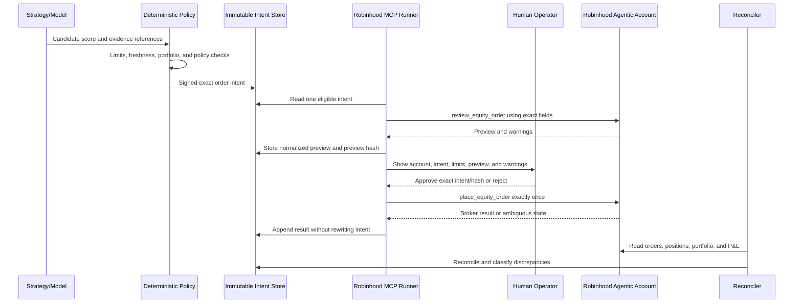

# Paper-to-Robinhood Agentic Rollout

**Research date:** 2026-07-23
**Status:** Proposed release policy. No broker connection, live flag change, deployment, or trade is authorized by this document.

## Release decision

The present application should remain paper-only, and Alpaca live should be treated as **no-go** until the release-blocking order-lifecycle defects below are fixed. This document supersedes any earlier go language for a supervised live canary while those defects remain. The safe path is:

```text
offline replay
→ deterministic fake broker
→ Alpaca paper
→ live-market shadow
→ Robinhood read-only shadow
→ Robinhood order review
→ supervised Robinhood canary
→ repeated canaries
→ tightly limited live tier
→ separately approved autonomy
```

No stage may be skipped. Promotion is manual and evidence-based. Demotion is automatic and immediate.

Robinhood now provides an official Trading MCP for a dedicated Agentic account. Its documented tools include account/portfolio reads, equity market data, positions, orders, tradability, `review_equity_order`, `place_equity_order`, and cancellation. Robinhood's reviewed documentation describes live order review and placement, but not a Robinhood paper-trading account. `review_equity_order` is a pre-trade simulation/warning step; it is **not** evidence of broker fill behavior and must not be labeled paper trading.

Robinhood's current order-type documentation does not support bracket orders. The present Alpaca-style protected-entry lifecycle therefore cannot be copied to Robinhood. Until the actual MCP schema and a separately tested protection workflow prove otherwise, every Robinhood entry canary must have an operator present, a predeclared manual broker-app fallback, and a separately reviewed risk-reducing exit plan.

## Non-negotiable safety boundary

- Disable the current live replacement path until amendments become new immutable, re-authorized intents.
- Classify timeouts and other possibly accepted submissions as `SUBMIT_UNKNOWN`; never turn uncertainty into a retry under a new client ID.
- Use only the official Robinhood Trading MCP endpoint: `https://agent.robinhood.com/mcp/trading`.
- Use a dedicated Robinhood Agentic account with separately bounded capital.
- Never collect or automate a consumer username, password, MFA code, browser session, or undocumented endpoint.
- Never place a Robinhood order directly from an LLM-generated narrative.
- The application creates one canonical immutable intent; the MCP runner may only transmit its exact approved fields.
- Require explicit user confirmation for every Robinhood order throughout dry-run, first-canary, and repeat-canary stages.
- Do not enable options, shorts, leverage, extended hours, or unattended execution in the initial release.
- A timeout or ambiguous response after submission is `UNKNOWN`, not `FAILED`. Freeze new risk, look up the order, and reconcile; do not blindly retry.
- No model, prompt, strategy, universe, data source, feature, broker schema, or risk-policy change is allowed inside a frozen evidence cohort.
- No automatic promotion. A passing stage only makes the next human review eligible.

## Target integration



### Boundary components

1. **Application core:** research, frozen strategy, portfolio policy, risk checks, and immutable `OrderIntent`.
2. **Robinhood MCP operator runner:** a narrow supervised process with the official MCP connection. It discovers the current tool schema at runtime and never assumes undocumented arguments.
3. **Human step-up authorization:** approval bound to exact account, deployment, intent hash, preview hash, policy/envelope version, maximum notional, and expiration.
4. **Reconciliation:** independent reads of orders, positions, buying power, and P&L; append-only mapping to the local lifecycle.

Near term, keep Robinhood authentication out of the general backend and in the supervised MCP runner. The runner should receive an exact intent through a narrow authenticated read interface or signed export. Do not expose arbitrary strategy prompts to the brokerage connection.

### Idempotency and uncertain submission

If the current Robinhood tool schema exposes a broker-supported client/correlation ID, bind it to the local intent and reuse the same value. If it does not:

1. Acquire a durable single-submit claim for the exact intent.
2. Re-read account, tradability, positions, open orders, buying power, quote, policy, and expiration.
3. Store the review result and approval before the place call.
4. Make one place call.
5. If the call times out, returns an indeterminate error, or the process crashes, mark the intent `SUBMIT_UNKNOWN`.
6. Freeze new risk for the account/symbol.
7. Query equity orders and positions using all documented identifying fields and a bounded time window.
8. Resolve to accepted/rejected only from broker evidence. Escalate unresolved ambiguity to the operator.
9. Never create a replacement intent merely to “try again.”

## Stage gates

The numbers below are conservative starter gates. The user must approve the final capital and loss values for the dedicated account before any live stage. A stricter existing server-side limit wins.

### Stage -1 — live freeze and P0 containment

**Allowed:** local inspection, remediation, deterministic tests, paper-only fixtures.
**Forbidden:** every Alpaca or Robinhood live write.

Release blockers:

- the baseline live-replace bypass is contained by X0.1; re-enablement remains
  prohibited until replacement uses the complete live flag, activation, attempt,
  immutable-intent, authorization, and risk envelope;
- preserve protective-stop submission uncertainty and prohibit duplicate retry;
- preserve paper-order submission uncertainty so paper evidence is not corrupted by false rejection;
- model the full broker lifecycle, including pending cancel/replace, replacement chains, partial fills, corrections, and event reordering;
- bind approvals to verified broker account, endpoint, credential identity, deployment, policy, and limits;
- allowlist exact broker origins and prohibit redirects;
- make an unowned broker order or unexplained position a global circuit breaker;
- persist the durable safety latch before alert delivery or other downstream side effects.

Promotion requires fault-injection evidence that a process crash or timeout at every persistence/I/O boundary causes either exactly one attributable order or a durable frozen unknown state—never a duplicate, silent retry, or widened exposure.

### Stage 0 — offline research and sealed validation

**Allowed:** historical data, deterministic simulation, model training, evaluation, reporting.
**Forbidden:** broker authentication, external order review, order placement.

Promotion requires:

- all P0 items in the quant blueprint complete;
- immutable dataset and experiment IDs;
- no unresolved look-ahead, survivorship, corporate-action, synthetic-data, or timing defect;
- full trial ledger and untouched sealed holdout;
- positive net benchmark-relative result with uncertainty and multiple-testing diagnostics;
- positive result at 2× conservative costs; 3× stress reported;
- stable neighboring parameters and no unapproved P&L concentration;
- all backend, frontend, simulator, data-integrity, and leakage tests green.

### Stage 1 — deterministic broker-contract testing

**Allowed:** fake broker and recorded fixtures only.
**Forbidden:** Alpaca or Robinhood live orders.

Required scenarios:

- accepted, rejected, partial, canceled, expired, and replaced order;
- timeout before submit, timeout after possible submit, duplicate event, event reordering, and restart;
- split, dividend, halt, stale quote, price-collar breach, insufficient buying power, closed market, and non-tradable symbol;
- concurrent intents racing for the same exposure;
- alert failure, database delay, clock skew, reconciliation delay, and emergency stop.

Promotion requires exact cash/share conservation, zero duplicate submissions, correct unknown-state behavior, and deterministic replay.

### Stage 2 — Alpaca paper

Use staging-only Alpaca paper credentials and the existing pre-live plan. Freeze one strategy, parameter version, symbol cohort, policy, dataset/feature versions, and execution model.

Minimum promotion evidence:

- at least 30 calendar days and 20 distinct market sessions;
- at least 100 eligible decisions, including abstentions, so selectivity is measured;
- at least 50 comparable aggregate fills and at least 20 per intended symbol;
- zero unresolved reconciliation, ownership, duplicate, or protection discrepancy;
- fill completion at least 99% and rejection no greater than 5%, with every rejection retained and classified;
- predicted slippage/fill behavior covers the observed result within the pre-registered tolerance;
- complete data-freshness, broker-latency, order-lifecycle, and alert telemetry;
- successful emergency-stop, restart, broker-outage, stale-data, and unknown-submit drills;
- no strategy, model, prompt, feature, universe, or policy change during the cohort.

These are operational gates, not proof of investment return. Alpaca states that its paper environment omits several live frictions, so a live canary remains necessary to measure them.

### Stage 3 — live-market shadow

The frozen candidate observes live inputs and creates non-executable intents. It must not call a broker placement tool.

Minimum promotion evidence:

- at least 20 distinct market sessions;
- all decisions and abstentions recorded;
- zero policy bypass, future-data use, stale-data trade, or unresolved critical alert;
- shadow exposures remain inside the exact proposed live envelope;
- realized-after-the-fact reference returns and cost estimates remain within pre-registered degradation bands;
- no material feature, calibration, regime, or data-distribution drift;
- an independent go/no-go review signed against the exact evidence hash.

### Stage 4 — Robinhood read-only shadow

This stage requires explicit approval to connect and authenticate the official Robinhood Trading MCP. Use the dedicated Agentic account.

**Allowed:** documented account, portfolio, P&L, positions, orders, tradability, quote, historical, fundamental, financial, technical, and earnings reads.
**Forbidden:** `place_equity_order`, option placement, and any autonomous write.

Promotion requires:

- runtime-discovered MCP tool schemas captured and contract-tested;
- exact dedicated account allowlist and account fingerprint;
- buying power, positions, orders, and portfolio map correctly to local normalized models;
- least-authority review confirms that the execution runner cannot access secrets or unrelated mutation tools;
- stale reads, auth expiry, schema change, rate limit, and provider outage fail closed;
- reconciliation dry runs identify no unresolved mapping discrepancy.

### Stage 5 — Robinhood order-review dry run

This stage may call `review_equity_order` for an exact non-executable intent but may not call `place_equity_order`.

Promotion requires:

- at least 20 reviewed intents across at least 10 market sessions;
- 100% equality between canonical intent and normalized preview for symbol, side, amount/quantity, order type, price fields, time in force, and account;
- all warnings classified and surfaced;
- preview change, quote move, intent expiry, account change, or policy change invalidates approval;
- an end-to-end approval rehearsal proves that rejecting or timing out cannot place an order;
- the UI and evidence label this “broker review,” never “paper fill.”

### Stage 6 — first supervised Robinhood canary

The first live order uses real capital and requires a separate explicit user go/no-go.

Initial envelope:

| Control | First-canary ceiling |
| --- | --- |
| Assets | One approved, highly liquid, fractional-eligible long equity or ETF; no options. |
| Per-order notional | `min($25, 0.10% of verified dedicated-account equity)`, unless the broker minimum requires a separately approved amount. |
| Daily submitted/filled notional | Same as the one-order ceiling. |
| Attempts | One total attempt for the activation; rejection or unknown state consumes it. |
| Positions | At most one risk position created by the system. |
| Order style | Regular-hours marketable limit with deterministic price collar and bounded expiry; no open/close auction or extended hours. |
| Approval | Explicit human step-up approval for the exact intent and preview. |
| Monitoring | Operator present, fresh heartbeat, live alert channel, immediate reconciliation. |
| Activation | One account, one intent, one attempt, one session, short expiration. |

If the calculated notional is below a documented broker minimum, stop. Do not silently enlarge it.

After the attempt:

1. Disable/revoke the activation.
2. Reconcile broker order, fill, position, buying power, and P&L.
3. Calculate spread, implementation shortfall, slippage, latency, fees, and any price improvement.
4. Seal the intent, preview, approval, tool call/result, broker snapshots, reconciliation, TCA, logs, alerts, and operator notes.
5. If the entry filled, manage the tiny position under the predeclared operator plan. Any application-issued protective or closing order is a new immutable, reviewed, explicitly approved intent; a manual Robinhood action must be imported and reconciled as external broker truth.
6. Run a post-canary human review before another activation.

A first canary is evidence about supervised order transport and reconciliation. Without broker-native atomic protection, it is not evidence that autonomous entry protection is production-ready.

### Stage 7 — repeat Robinhood canaries

Keep per-order approval and the first-canary capital ceiling.

Promotion requires:

- at least 10 successful orders on 10 distinct market sessions;
- zero unresolved submit ambiguity, duplicate, reconciliation, ownership, policy, or account discrepancy;
- zero risk-limit or price-collar breach;
- predicted live cost interval covers realized cost, or the cost model has been conservatively refit and a new frozen cohort completed;
- all alerts delivered and all post-canary dossiers sealed;
- no material strategy/model/data/prompt/policy/MCP-schema change during the cohort;
- a cooling period and independent go/no-go review.

### Stage 8 — tightly limited live tier

This stage is still supervised and equity-only. It is not unrestricted autonomy.

Candidate starter envelope:

| Control | Initial limited-live ceiling |
| --- | --- |
| Per order | `min($100, 0.25% of verified dedicated-account equity)` |
| Gross system exposure | `min($500, 2% of verified dedicated-account equity)` |
| Positions | 2 |
| Attempts | 2 per regular-hours session, with per-symbol cooldown |
| Daily loss stop | The lower of a user-approved fixed dollar amount and 0.25% of verified account equity |
| Cohort drawdown stop | The lower of a user-approved fixed dollar amount and 1% of verified account equity |
| Approval | Explicit per-order approval remains required |
| Instruments | Long equities/ETFs only; no options, shorts, leverage, or extended hours |

The final fixed-dollar values must be supplied and approved by the user. The application may make limits stricter, never looser.

### Stage 9 — separately approved restricted autonomy

Do not implement or enable this stage merely because limited live trading succeeds. It requires:

- at least 60 reconciled live orders and 60 calendar days under the exact limited-live cohort;
- a statistically meaningful live TCA sample and no unresolved critical incident;
- verified automatic demotion, kill switch, alerting, credential rotation, disaster recovery, and operator runbook;
- independent model, risk, security, and execution review;
- an immutable autonomous capital envelope;
- explicit user authorization describing eligible strategies, symbols, hours, capital, losses, order types, rate, duration, and approval revocation.

Options require a separate simulator, Greeks and assignment/exercise lifecycle, liquidity/spread policy, risk envelope, paper cohort, Robinhood review cohort, and live canary program. Equity evidence does not promote an options strategy.

## Personal release versus commercialization

This plan assumes one owner trading a self-directed dedicated account. A multi-user product, paid signals, discretionary account control, copying trades across customers, or public performance marketing is a separate regulatory and product program. Before any such release:

- obtain securities counsel on investment-adviser, broker-dealer, auto-trading, marketing, recordkeeping, and state/federal requirements;
- complete privacy, cybersecurity, customer-support, complaints, business-continuity, and vendor/data-license programs;
- prohibit hypothetical or backtested performance claims that omit costs, selection effects, limitations, and material risks;
- make account authority, consent, revocation, suitability/appropriateness, and supervision explicit.

Do not infer that a safe personal-account canary makes a multi-user service compliant or safe.

## Promotion scorecard

Each stage emits a signed scorecard:

| Domain | Required state |
| --- | --- |
| Code | Commit/patch hash, tests, build, dependency and security results. |
| Data | Dataset/universe/source versions, freshness, quality, point-in-time and license checks. |
| Model | Strategy/features/model/prompt versions, calibration, drift, sealed validation. |
| Risk | Exact immutable envelope, current exposure, loss/drawdown, stress results. |
| Execution | Preview equality, broker schema/version, order lifecycle, fill/TCA, unknown-state count. |
| Operations | Readiness, heartbeat, alerts, reconciliation, drills, incidents. |
| Governance | Independent reviewer, operator, approval hashes, expiry, exceptions. |

Any `FAIL`, `UNKNOWN`, missing evidence, stale evidence, or hash mismatch blocks promotion.

## Automatic demotion and kill triggers

Block new risk before sending an alert when any of these occurs:

- emergency stop, user revocation, activation expiry, or heartbeat expiry;
- drawdown, daily loss, gross/net, concentration, position, notional, attempt, or order-rate limit reached;
- stale/missing/crossed market data or unavailable required source;
- unexpected symbol, account, side, quantity/notional, order type, price, time in force, or preview mismatch;
- duplicate, orphan, foreign, overfill, missing fill, broker/local state, buying-power, or position discrepancy;
- submission timeout or any state where placement may have happened but cannot be proven;
- broker authentication, schema, rate-limit, availability, or permission anomaly;
- model, strategy, feature, prompt, universe, data source, policy, envelope, or code hash changes;
- live slippage, rejection, latency, or fill metric breaches its registered band;
- critical alert delivery, audit persistence, database, clock, readiness, or reconciliation becomes stale;
- LLM output lacks required citations, violates schema, contains tool instructions from untrusted content, or fails an abstention rule.

Demotion sequence:

1. Atomically block new order claims.
2. Revoke active authorization and activation.
3. Mark ambiguous states and reconcile before cancel/replace decisions.
4. Cancel only locally owned working orders when policy says cancellation reduces risk.
5. Preserve protective/risk-reducing actions within a separately bounded path.
6. Emit and retry the critical alert.
7. Retain all evidence.
8. Require human incident review and a new evidence assessment before re-arming.

## Release and rollback checklist

Before every Robinhood live activation:

- [ ] User approved the exact account, capital/loss envelope, intent, and expiration.
- [ ] Dedicated Agentic account and account fingerprint match.
- [ ] No options, shorts, leverage, transfers, withdrawals, or unrelated mutation capability.
- [ ] Intent, preview, policy, data, model, and deployment hashes match.
- [ ] Quote and all required data are fresh; market/session policy permits the order.
- [ ] Buying power, current positions, open orders, and projected exposure reconcile.
- [ ] Alerts, heartbeat, audit store, readiness, and reconciler are healthy.
- [ ] One-shot claim exists; attempt capacity remains.
- [ ] Operator can immediately invoke the emergency stop.

Rollback:

1. Block new risk and revoke activation.
2. Query the broker before assuming an uncertain order failed.
3. Reconcile orders, fills, positions, buying power, and P&L.
4. Cancel only verified locally owned working orders when risk-reducing.
5. Preserve evidence and seal an incident dossier.
6. Rotate/revoke the MCP connection if authorization or account scope is in doubt.
7. Remain in the prior safe stage until a new human go/no-go.

## Sources

- [Robinhood Agentic Trading overview](https://robinhood.com/us/en/support/articles/agentic-trading-overview/)
- [Robinhood Trading with your agent and current tools](https://robinhood.com/us/en/support/articles/trading-with-your-agent/)
- [Robinhood order types](https://robinhood.com/us/en/support/articles/order-types/?hcs=true)
- [Robinhood order routing and execution quality](https://robinhood.com/us/en/support/articles/stocks-order-routing-and-execution-quality/)
- [Alpaca paper-trading limitations](https://docs.alpaca.markets/us/docs/paper-trading)
- [Alpaca order-update streaming](https://docs.alpaca.markets/us/docs/websocket-streaming)
- [FINRA algorithmic-trading control guidance](https://www.finra.org/rules-guidance/notices/15-09)
- [FINRA warning on unregistered auto-trading services](https://www.finra.org/investors/insights/auto-trading-unregistered-entities)
- [SEC Rule 605 execution-quality FAQ](https://www.sec.gov/rules-regulations/staff-guidance/trading-markets-frequently-asked-questions/frequently-asked-questions-rule-605-regulation-nms)
- [SEC robo-adviser guidance release](https://www.sec.gov/newsroom/press-releases/2017-52)

This rollout reduces preventable risk; it cannot make a strategy profitable or eliminate the possibility of losing the entire dedicated account.
