# Quant Platform Research and Optimization Blueprint

**Research date:** 2026-07-23
**Scope:** `day-trader-sprint1` repository, its present Alpaca paper/live controls, research services, backtester, recommendation engine, and the proposed Robinhood Agentic Trading path
**Decision status:** Research and engineering blueprint. This document does not authorize a deployment, broker connection, or trade.

## Executive conclusion

This application already has a stronger operational safety foundation than most retail trading prototypes: immutable order fingerprints, fail-closed readiness, reconciliation, shadow evaluation, paper evidence, an emergency stop, supervised canaries, and a substantial automated test suite. The next unit of value is not another strategy or a more eloquent LLM. It is a trustworthy research substrate.

The present system is **not ready to claim statistically defensible alpha, to route Alpaca live orders, or to route Robinhood orders**. Its most important gaps are:

1. At the baseline audit, the live replacement endpoint could bypass the controlled-live activation, authorization, fingerprint, attempt, and notional envelope. X0.1 now contains that route, but the complete immutable amendment lifecycle remains unimplemented.
2. An ambiguous protective-stop submission can be marked rejected and retried under a new client ID, creating duplicate exits.
3. The default walk-forward validation cannot receive enough bars to satisfy its own gate.
4. Synthetic fallback news can be persisted and can influence the screener.
5. Backtest strategy selection differs from live strategy selection, and stored “parameter versions” are not executable inputs.
6. The backtester is a single-symbol, fixed-notional simulator with optimistic timing and incomplete execution economics.
7. Fill records can be counted as independent trades, inflating promotion evidence and distorting performance metrics.
8. Price, news, event, universe, and model data are not stored as a point-in-time, reproducible dataset.
9. The strategy and recommendation scores are hand-tuned heuristics without calibration, uncertainty estimates, or multiple-testing control.
10. Portfolio risk uses useful hard limits but not empirical covariance, factor/sector stress, expected shortfall, or liquidity-aware sizing.
11. Robinhood appears only as an allowed enum value. The executable worker and reconciliation path are Alpaca-specific.

The economic objective should be:

> Maximize reproducible, net, risk-adjusted excess return subject to hard loss, drawdown, liquidity, concentration, operational, and evidence constraints.

Raw return is not the primary objective. A high backtest return obtained through leakage, unrecorded experiments, optimistic fills, or concentrated tail risk has negative value.

## Current-state scorecard

These scores are an engineering assessment, not an investment-performance rating or certification.

| Capability | Current maturity | Evidence and interpretation |
| --- | ---: | --- |
| Operational safety and auditability | 3/5 | Strong reconciliation, fingerprinting, readiness, emergency-stop, shadow, and supervised-canary primitives. X0.1 contains the baseline live-replacement route, but immutable amendments remain prohibited and protective-stop uncertainty is still release-blocking. |
| Automated software testing | 4/5 | At this audit point, backend tests reported 430 passed, 0 failed, 1 skipped out of 431; frontend tests reported 8 passed. Coverage is strongest around workflow safety, not statistical validity. |
| Historical data correctness | 1.5/5 | Short, unpaginated raw-price requests; no immutable point-in-time dataset, delisted universe, or corporate-action ledger. |
| Backtest realism | 1.5/5 | Single symbol/position, same-bar assumptions, fixed costs and notional, no portfolio accounting or market-impact model. |
| Statistical validation | 1.5/5 | Rolling out-of-sample windows exist, but there is no train-time fitting, sealed holdout, experiment ledger, multiple-testing correction, or confidence analysis. |
| Strategy research | 2/5 | Sensible technical baselines exist, but scores, thresholds, regime rules, and weights are mostly handcrafted. |
| Portfolio construction and market risk | 2.5/5 | Strong deterministic exposure controls; limited empirical correlation, factor, liquidity, stress, and tail-risk modeling. |
| News, event, and social intelligence | 1.5/5 | News and corporate events are ingested, but sentiment is keyword-based, synthetic fallback is unsafe, and point-in-time provenance is incomplete. |
| LLM integration | 2/5 | LLM summaries are separated from execution, which is good; schemas, evaluations, prompt/model lineage, injection defenses, and calibration need work. |
| Broker portability / Robinhood | 1/5 | The domain enum anticipates Robinhood, but order creation, placement, and reconciliation are hard-wired to Alpaca. |

## Confirmed P0 defects

### P0-0A: live replacement bypasses the controlled-live envelope

**Containment status (2026-07-23):** X0.1 now returns HTTP `409` with
`LIVE_ORDER_REPLACEMENT_DISABLED` for the live replacement route before replacement
broker I/O. This contains the baseline reachable defect only. Live amendments remain
prohibited, and the immutable intent, fingerprint, risk, authorization, attempt, and
replacement-chain lifecycle below is still required before any re-enablement.

At the baseline audit, [`backend/routes/robotrader.js`](../backend/routes/robotrader.js)
could send a live order replacement after an operator/settings check without requiring
the deployment live flag, an active controlled-live activation, an unused attempt, a
new canonical intent/fingerprint, exact authorization, or a fresh
risk/notional/exposure check.
[`backend/robotrader/alpacaBroker.js`](../backend/robotrader/alpacaBroker.js) accepted
replacement economic fields, while the local order and fingerprint were not fully
rewritten to reflect those fields.

At baseline, this meant a previously approved small order could be amended outside the
envelope and the local evidence could cease to describe broker truth. Setting only
`LIVE_TRADING_ENABLED=false` was not a sufficient safety action for that reachable
route.

**Required correction**

- Keep live replacement disabled. X0.1 supplies route-level containment but does not
  authorize re-enablement.
- Reintroduce an amendment only as a new immutable intent with a new fingerprint, risk evaluation, exact authorization, attempt/capacity claim, and replacement-chain record.
- Compare all amended broker economics against the authorized intent during reconciliation.
- Add tests proving replacement cannot widen quantity, notional, price, time in force, or exposure after any flag, activation, authorization, attempt, or policy gate changes.

### P0-0B: ambiguous protective-stop submission can create duplicate exits

[`backend/robotrader/reconciliation.js`](../backend/robotrader/reconciliation.js) can classify every protective-stop submission error—including a timeout after possible broker acceptance—as rejected. Rejected protection is retryable, and a retry can use a new client ID. If the first stop was accepted but its response was lost, both stops can exist and an exit overfill can create unintended opposite-side exposure.

**Required correction**

- Distinguish `SUBMIT_UNKNOWN` from a broker-confirmed rejection.
- Retain the original client/correlation identity and never retry an unknown outcome under a new identity.
- Freeze new risk while broker orders, positions, and account activity are queried.
- Permit resubmission only after bounded, independently corroborated evidence that the original did not reach the broker.
- Prefer broker-native atomic protection where it exists; otherwise bind protection to a tested adapter capability and SLO.

### P0-1: the documented default walk-forward gate is unattainable

[`backend/tradeLogic.js`](../backend/tradeLogic.js) requests at most 200 daily bars from the last 400 calendar days, uses raw prices, and does not paginate. [`backend/services/walkForwardValidationService.js`](../backend/services/walkForwardValidationService.js) defaults to 252 training bars, 63 test bars, a 63-bar step, and at least three independent test windows.

The minimum required history is:

```text
252 training bars + (3 × 63 test bars) = 441 trading bars
```

The production route therefore cannot create a qualifying default run from a 200-bar fetch. Synthetic unit tests pass because they use reduced 100/20/20 parameters; they do not prove that the production route can satisfy the documented promotion gate.

**Required correction**

- Introduce one paginated historical-data service used by research and backtesting.
- Fetch enough history for the requested training, validation, embargo, and test layout before the run starts.
- Reject the run with an explicit `INSUFFICIENT_POINT_IN_TIME_HISTORY` result when the requirement is unmet.
- Add a route-level test using default parameters that asserts the number and dates of windows.
- Rename the current operation to “rolling out-of-sample evaluation” unless a training window actually selects or fits a model without observing its test window.

### P0-2: fabricated fallback news can enter a score

[`backend/services/researchService.js`](../backend/services/researchService.js) creates `research_fallback` headlines when Alpaca news credentials or requests fail. `refreshNewsDetailed` persists all returned items, while `scoreScreenerRow` consumes persisted news sentiment without excluding synthetic items.

An availability failure can therefore produce fabricated current-timestamp content that changes a ranking. A warning is not a sufficient control.

**Required correction**

- Never persist generated placeholders into a research or feature collection.
- Store provider-health events separately from market observations.
- Add mandatory `isSynthetic`, `sourceType`, `observedAt`, `availableAt`, `contentHash`, `licensePolicyId`, and ingestion-version fields.
- Enforce a hard rule: synthetic, unknown-provenance, stale, or future-unavailable content contributes exactly zero to every feature, score, decision, and order.
- Add an invariant test proving that provider failure does not change a symbol score or order intent.

### P0-3: simulation timing and fills can overstate performance

[`backend/backtest/backtestEngine.js`](../backend/backtest/backtestEngine.js) can derive a signal from a completed bar and enter at that same bar's close. It also resolves a bar that crosses both a stop and target using a fixed branch order, not an explicit intrabar path policy. Friction is primarily a fixed basis-point assumption, and the simulator does not model partial fills, queueing, market impact, rejected orders, cash competition, or portfolio exposure.

**Required correction**

- Make the default decision clock explicit: information available at `t` may execute no earlier than the configured event at `t+1`.
- Support conservative policies for ambiguous stop/target bars, with the policy recorded in each run.
- Replay bid/ask or quote-derived spread when available; otherwise use a documented conservative proxy.
- Model participation, volatility, spread, latency, fees, partial fills, cancels, rejects, and terminal liquidation.
- Keep signal-price data and accounting-price data separate so corporate actions are handled once, not ignored or double counted.

### P0-4: research is not reproducible point in time

Current models do not consistently distinguish when an event occurred, was published, first became observable to this system, became safe to use, was ingested, or was revised. Raw adjustment is used in key bar fetches, and the universe is a current static symbol list. This creates look-ahead, corporate-action, survivorship, and revision risks.

**Required correction**

Every observation must carry:

```text
eventTime
publishedAt
firstObservedAt
availableAt
ingestedAt
revisedAt
source
sourceRecordId
contentHash
schemaVersion
ingestionVersion
licensePolicyId
```

Backtests may query only records whose `availableAt <= decisionTime`. Historical universes must include delistings and membership changes. Signals may use a consistently adjusted series, while executions and P&L use raw tradable prices plus an explicit split/dividend/corporate-action ledger.

### P0-5: Robinhood is a placeholder, not an executable broker

[`backend/models/OrderIntent.js`](../backend/models/OrderIntent.js) permits `robinhood` in an enum. The executable worker assigns `broker: 'alpaca'`, and the current live lifecycle, credentials, lookup, and reconciliation are Alpaca-specific.

The official route is Robinhood's Trading MCP connected to a dedicated Agentic account. Do not scrape Robinhood, automate a consumer login, reuse a crypto-only API for equities, or infer undocumented endpoints.

The broker-neutral intent and release boundary are specified in [Paper-to-Robinhood Agentic Rollout](./paper-to-robinhood-agentic-rollout.md).

### P0-6: backtest and live do not execute the same strategy contract

The backtester evaluates all Robo candidates and enters only when the global winner matches the requested strategy. Live evaluation filters to the configured `activeStrategyId` before selecting. A backtest labeled for one strategy can therefore depend on competing strategies that live mode would not evaluate. Stored parameter-version records are checked for identity and copied into evidence, but their parameter payload is not consistently applied to the strategy calculations.

**Required correction**

- Define one pure, versioned strategy function used by backtest, paper, shadow, and live.
- Make every threshold, feature definition, feature cutoff, sizing rule, exit, and compatible schema an executable part of the version.
- Bind strategy-content, parameter, feature-schema, code, data, and execution-model hashes to every run and intent.
- Add a golden parity fixture: identical point-in-time inputs and version must produce identical features, signal, score, side, target, stop, and intended size in every mode.

### P0-7: fills are not independent trades

The paper trade model represents filled orders, including entries with no realized P&L. Some analytics and promotion paths count those records directly as “trades,” so an entry plus partial exits or scale-ins can inflate sample size. A “30-trade” gate need not mean 30 independent round trips. Trade-level R dispersion is also not a time-series Sharpe ratio, and realized-fill P&L is not a mark-to-market equity curve.

**Required correction**

- Keep immutable fills as execution events.
- Add canonical lots, positions, and round-trip trade episodes.
- Count independent closed episodes for expectancy/sample gates.
- Compute CAGR, Sharpe, Sortino, drawdown, and tail risk from a time-indexed, mark-to-market portfolio equity series.
- Reconcile episode P&L to fills, fees, corporate actions, and broker equity within an explicit tolerance.

## Target architecture

```mermaid
flowchart LR
    A["Licensed market, filing, news, event, and social sources"] --> B["Immutable point-in-time observation store"]
    B --> C["Versioned feature pipeline"]
    C --> D["Experiment registry and leakage-safe research runner"]
    D --> E["Event-driven portfolio simulator"]
    E --> F["Statistical validation and sealed holdout"]
    F --> G["Candidate model registry"]
    G --> H["Shadow decision engine"]
    H --> I["Deterministic portfolio and risk policy"]
    I --> J["Immutable signed order intent"]
    J --> K["Broker preview and human authorization"]
    K --> L["Broker adapter / Robinhood Trading MCP"]
    L --> M["Orders, fills, positions, and reconciliation"]
    M --> N["TCA, drift, incidents, and automatic demotion"]
    N --> B

    O["LLM extraction, research, and independent critique"] --> C
    O --> D
    O -. "never direct order authority" .-> J
```



The central rule is a one-way trust boundary: probabilistic models may propose scores and explanations; deterministic, versioned code creates and constrains order intents. An LLM must never invent or mutate executable order arguments after policy approval.

## Data and feature platform

### Source hierarchy

| Tier | Examples | Initial use | Rule |
| --- | --- | --- | --- |
| 0: market truth | Trades, quotes, bars, exchange calendar, security master, splits, dividends, halts | Signals, simulation, risk, TCA | Mandatory and point-in-time before alpha work. |
| 1: authoritative events | SEC filings/XBRL, issuer releases, earnings calendar/results, macro series | Event features and risk exclusions | Store original document, release time, first-observed time, revisions, and parsing lineage. |
| 2: licensed news | Alpaca or another licensed feed with timestamps and identifiers | Event classification, novelty, narrative dispersion | No placeholder content; deduplicate syndication; respect entitlements. |
| 3: social/attention | Contracted Reddit/X/Stocktwits or another approved source | Research-only attention and disagreement features | No scraping. Manipulation/bot filters, source terms, privacy, and ablation evidence are mandatory. |

Social data should begin as a risk and attention signal, not a directional oracle. It is adversarial, reflexive, selection-biased, and vulnerable to coordinated promotion. A feature does not advance merely because an LLM can summarize it.

### Offline/online parity

- Define every feature once with a versioned specification.
- Compute historical and live features with the same implementation or golden-vector contract tests.
- Record lookback, lag, missing-data policy, winsorization, universe, timezone, calendar, and normalization.
- Fail closed when the feature would need data not yet available at decision time.
- Persist the exact feature vector and source-record IDs used by each decision.

### Dataset and experiment identity

Every experiment should have an immutable run record containing:

- hypothesis and economic rationale;
- owner and experiment family;
- all attempted variants, including failed and abandoned trials;
- Git commit and dirty-worktree patch hash;
- dataset snapshot and universe version;
- feature, strategy, model, prompt, and cost-model versions;
- random seeds and environment;
- train/validation/test boundaries and embargo;
- raw and net results, statistical diagnostics, artifacts, and decision;
- whether the sealed holdout has ever been opened.

This ledger is the defense against accidental p-hacking and “best backtest wins.”

## Research and statistical validation standard

### Data splits

1. **Development train:** fitting and broad exploration.
2. **Development validation:** model/parameter selection.
3. **Rolling out-of-sample:** realistic sequential refits using only prior information.
4. **Sealed holdout:** opened once for a pre-registered candidate and never reused for tuning.
5. **Forward paper/shadow:** frozen code, parameters, universe, prompts, and data policy.

For overlapping labels or strategies whose trades span folds, purge samples and add an embargo. Use combinatorial purged cross-validation as a robustness diagnostic where the data shape supports it; it complements, rather than replaces, chronological walk-forward evaluation.

### Multiple-testing and uncertainty controls

- Log every trial in an experiment family, not only the selected result.
- Report probabilistic and deflated Sharpe diagnostics when return frequency and sample size make them meaningful.
- Estimate probability of backtest overfitting across candidate selections.
- Use stationary/block bootstrap confidence intervals for dependent returns.
- Test parameter plateaus, not one sharp optimum.
- Attribute P&L by symbol, month, regime, event type, and factor exposure.
- Compare against a simple benchmark and the simplest viable version of the strategy.
- Require an ablation for every new feature, model, news source, or LLM stage.

A fixed “30 trades and average R above zero” rule is too weak to establish alpha. Trade count must be supplemented by effective independent sample size, time coverage, regimes, uncertainty, and concentration.

### Minimum metrics

Report these for gross and net results, overall and by slice:

- CAGR or annualized return, annualized volatility, Sharpe, Sortino, Calmar;
- maximum and expected drawdown, recovery time, tail loss and expected shortfall;
- alpha/beta and factor/sector exposures where appropriate;
- hit rate, payoff ratio, expectancy, profit factor, turnover, holding time, exposure;
- trade count and effective independent sample size;
- spread, slippage, fees, market impact, fill/reject/cancel/partial-fill rates;
- capacity at several participation assumptions;
- parameter sensitivity, feature ablations, and benchmark deltas;
- confidence intervals, probabilistic/deflated Sharpe, and overfit diagnostics.

### Cost and failure stress matrix

Every candidate must survive, at minimum:

| Stress | Required comparison |
| --- | --- |
| Trading costs | Baseline observed/proxy cost, 2× cost, and 3× cost. |
| Latency | Decision-to-submit and submit-to-fill delays at median, p95, and an outage case. |
| Liquidity | Lower volume, wider spread, capped participation, and partial fill. |
| Order lifecycle | Reject, cancel race, stale order, partial fill, duplicate callback, timeout with unknown submit status. |
| Market conditions | High volatility, gap, fast selloff, sideways/choppy period, and recovery. |
| Data | Missing bar, late quote, stale event, revision, provider outage, and crossed/bad market. |
| Infrastructure | Process restart, database delay, broker disconnect, clock skew, alert outage, and reconciliation lag. |

## Strategy research roadmap

The highest-probability research program for this application's latency and brokerage context is liquid, lower-turnover, long-only equities and ETFs—not high-frequency market making, unrestricted options, or social-media chasing.

### Baselines first

1. Cash and buy-and-hold benchmark.
2. Equal-weight approved universe.
3. Volatility-scaled time-series trend.
4. Cross-sectional momentum with liquidity and sector constraints.
5. Short-horizon mean reversion with regime and event exclusions.

These baselines establish whether complexity adds value after costs.

### Prioritized hypotheses

| Priority | Hypothesis | Why it may persist | Essential falsification tests |
| --- | --- | --- | --- |
| 1 | Volatility-scaled trend/momentum across liquid ETFs and equities | Behavioral underreaction and slow capital reallocation | Sideways regimes, crash reversals, sector-neutral residual version, 2×/3× costs. |
| 2 | Cross-sectional residual momentum | Removes broad market/sector moves and targets idiosyncratic continuation | Point-in-time universe, turnover/capacity, factor neutrality, delisted names. |
| 3 | Regime-gated short-term mean reversion | Liquidity provision after non-informational dislocations | Exclude earnings/news shocks, gap stress, spread/queue assumptions, crash regimes. |
| 4 | Post-event drift from earnings and SEC filing changes | Information diffusion and investor underreaction | Exact release availability, after-hours handling, novelty extraction, crowded-event costs. |
| 5 | News novelty and disagreement as a gate or risk reducer | Repeated stories add little; disagreement can flag uncertainty | Licensed source only, syndication dedupe, timestamp lag, no-news baseline, LLM ablation. |
| 6 | Social attention shock as a risk/size modifier | Attention may predict volatility and crowdedness | Bot/manipulation filters, source stability, legal rights, directional-vs-risk ablation. |

Each hypothesis gets a complexity budget. If a simple, transparent version is not robust, a larger model does not rescue it.

## Portfolio construction and risk

Replace strategy-local “maximum trade amount × confidence multiplier” sizing with a portfolio-level allocator:

1. Convert scores to calibrated expected return distributions, not arbitrary confidence percentages.
2. Estimate volatility and a shrinkage covariance/factor model using point-in-time data.
3. Apply volatility targeting and risk budgets by strategy, symbol, sector, factor, and correlated cluster.
4. Enforce gross/net, concentration, liquidity, turnover, order-rate, overnight, and event-risk limits.
5. Use fractional-Kelly sizing only as an offline research comparison; cap it aggressively and never let it bypass hard limits.
6. Stress gaps, volatility jumps, correlation-to-one, missing liquidity, and stale-data behavior before intent creation.
7. Calculate expected shortfall and scenario loss alongside deterministic maximum-loss limits.

Optimization should be robust to estimation error. Prefer constrained, shrunk, or risk-budgeted allocations over an unconstrained mean-variance optimum.

## AI integration: useful roles and forbidden roles

### Good uses

- Extract structured facts and timestamps from filings, releases, and news.
- Classify event type, novelty, uncertainty, contradiction, and affected entities.
- Summarize source-grounded bull, bear, and invalidation cases for human research.
- Generate research hypotheses and adversarial critiques.
- Detect data anomalies, schema drift, and conflicting sources.
- Produce incident summaries and explain deterministic risk rejections.

### Forbidden until separately proven and approved

- Free-form generation of symbol, side, quantity, price, order type, or time in force.
- Treating prose “confidence” as a calibrated probability or position-size input.
- Allowing web/news/social content to supply tool instructions.
- Self-approving a model it created or tuned.
- Changing a strategy, prompt, model, data source, or risk limit during a forward evidence window.
- Using an LLM response directly as a broker payload.

### Model and evaluation policy

- Benchmark models on a versioned golden set before changing providers, models, prompts, schemas, or reasoning effort.
- Use a lower-cost model for high-volume extraction only if it meets the accuracy and citation bar.
- Use a frontier model for offline hypothesis synthesis, code review, and independent critique when measured quality justifies cost.
- Prefer the Responses API and strict structured outputs for new OpenAI work after an evaluation-backed migration.
- Pin the model snapshot where available; record model, prompt, tool schema, token cost, latency, and output hash.
- Use deterministic parsers and validators after model output.
- Red-team prompt injection, source spoofing, ticker ambiguity, unit errors, stale news, missing citations, and abstention.
- Evaluate field-level precision/recall, timestamp accuracy, citation entailment, calibration, abstention quality, stability, latency, and cost.
- Keep the final order policy and broker call deterministic.

As of the research date, OpenAI documents `gpt-5.6-sol` as the flagship model, `gpt-5.6-terra` as a cost/performance balance, and `gpt-5.6-luna` for efficient high-volume work. Those names are inputs to an evaluation, not a mandate to use the largest model everywhere.

## Broker-neutral execution boundary

Introduce narrow capability interfaces rather than a monolithic broker object:

```text
BrokerAccountReader
BrokerMarketDataReader
BrokerOrderPreviewer
BrokerOrderPlacer
BrokerOrderCanceler
BrokerOrderReconciler
BrokerCapabilities
```

An `OrderIntent` must bind:

```text
intentId + contentHash
accountId and broker
symbol + asset type
side + quantity/notional
order type + limit/stop + time in force
strategy/model/feature/data/prompt versions
risk snapshot + policy/envelope version
market-data reference and freshness
expiration
authorization state
```

Preview, approval, submission, broker response, status changes, fills, positions, TCA, and reconciliation must append to the audit trail. No stage may silently rewrite the intent.

## Prioritized implementation program

### Sprint X0 — live freeze and order-lifecycle containment

- Keep every live path disabled and explicitly disable live replacement.
- Fix protective-stop and paper-order ambiguous-submit classification.
- Introduce a canonical order state machine and append-only event journal.
- Bind broker account, endpoint, credential public-identity hash, deployment, policy, and limits into approval.
- Make unexplained broker orders or positions an account-global circuit breaker.
- Allowlist the exact broker production origin; prohibit redirects and credential transmission to arbitrary hosts.

**Exit:** No path can replace, submit, retry, cancel, or close outside an immutable intent/command lifecycle; every uncertain outcome freezes risk and reconciles without a duplicate; account/deployment drift invalidates approval.

### Sprint Q0 — research truth and contamination controls

- Fix historical pagination and bar sufficiency.
- Introduce point-in-time observation metadata and corporate-action semantics.
- Quarantine synthetic news and provider-health placeholders.
- Unify the executable strategy/parameter contract across backtest, paper, shadow, and live.
- Separate fill events, lots, positions, round-trip episodes, and portfolio equity.
- Rename or extend the current walk-forward operation accurately.
- Add production-route invariant tests for all three corrections.

**Exit:** A default walk-forward run can produce its required windows from a versioned dataset; provider failure cannot alter any feature or decision; strategy parity and episode accounting fixtures pass; time availability tests pass.

### Sprint Q1 — event-driven portfolio simulator v2

- Add explicit event clock and next-event execution.
- Add portfolio cash, positions, multiple symbols, pending orders, partial fills, rejects, cancels, and ambiguous-submit states.
- Add configurable spread/slippage/participation/latency/fee models and conservative ambiguous-bar policy.
- Add splits, dividends, delistings, halts, and terminal handling.
- Add benchmark and expanded metric reports.

**Exit:** Golden scenarios reconcile cash and positions exactly; look-ahead tests fail when deliberately poisoned; cost and failure stress matrices are reproducible.

### Sprint Q2 — experiment registry and statistical gates

- Build immutable dataset/run/model registries.
- Implement train/validation/rolling-OOS/sealed-holdout workflow with purge/embargo.
- Log all attempted variants.
- Add bootstrap intervals, probabilistic/deflated Sharpe, concentration, sensitivity, and overfit diagnostics.
- Produce a machine-readable evidence bundle and human report.

**Exit:** A candidate cannot be promoted without complete lineage, all trials, a still-sealed holdout, and pre-registered gates.

### Sprint Q3 — strategy and portfolio research

- Establish simple baselines and benchmark-relative reporting.
- Research the prioritized hypotheses one family at a time.
- Calibrate scores and abstention; add empirical covariance/factor/liquidity risk.
- Add robust portfolio allocation and stress tests.

**Exit:** At least one candidate beats its simple benchmark net of stressed costs without relying on one symbol, month, regime, or narrow parameter optimum—or the evidence records an honest no-alpha result.

### Sprint Q4 — event intelligence and LLM evaluations

- Ingest point-in-time SEC/earnings/news sources with provenance and licensing.
- Add structured extraction with source citations and prompt-injection isolation.
- Build a golden evaluation set and model/prompt registry.
- Keep social data research-only until manipulation, licensing, and ablation gates pass.

**Exit:** Each model-backed field meets its pre-registered accuracy, timestamp, citation, calibration, abstention, latency, and cost thresholds; failure cannot create a trade signal.

### Sprint Q5 — frozen paper and shadow evidence

- Freeze exact dataset, feature, model, strategy, prompt, policy, universe, and cost versions.
- Run deterministic replay, fake broker, Alpaca paper, and shadow evaluation.
- Compare predicted and observed execution with TCA and discrepancy dashboards.
- Drill outages, uncertain submit, duplicate prevention, emergency stop, and automatic demotion.

**Exit:** All paper/shadow promotion gates in the rollout document pass with zero unresolved critical discrepancies.

### Sprint Q6 — Robinhood dry-run integration

- Add the broker-neutral intent boundary.
- Connect the official Robinhood Trading MCP only after explicit user approval.
- Exercise read-only shadow and `review_equity_order`; do not place an order.
- Bind an exact reviewed preview to a step-up approval and audit hash.

**Exit:** Contract, preview, account, risk, timeout, mismatch, and reconciliation tests pass. The review result is not misrepresented as paper trading.

### Sprint Q7 — supervised Robinhood canaries

- Execute only the user-approved dedicated-account canary envelope.
- Require per-order human approval and one-shot submission.
- Reconcile immediately and seal the evidence packet.
- Automatically demote on any trigger in the rollout document.

**Exit:** The required number of distinct-session canaries pass. Capital limits remain fixed; promotion only authorizes a separately reviewed next tier.

## Candidate research-promotion gates

These are minimum engineering defaults to pre-register, then calibrate to the strategy horizon and account. They must never be tuned after seeing the candidate's result merely to make it pass.

| Gate | Candidate minimum |
| --- | --- |
| Reproducibility | Same code, dataset snapshot, seed, and configuration recreate the signed result within declared numeric tolerance. |
| Data integrity | Zero unresolved look-ahead, survivorship, corporate-action, timezone, revision, provenance, or synthetic-data finding. |
| Holdout discipline | The sealed holdout was opened once for a registered candidate; no subsequent tuning uses it. |
| Statistical evidence | Positive net benchmark-relative expectancy with bootstrap interval and probabilistic/deflated Sharpe evidence appropriate to frequency; all trial counts disclosed. |
| Cost robustness | Positive net objective at 2× the conservative baseline cost; 3× result reported and used as a risk scenario. |
| Stability | No single symbol, month, or regime supplies more than a pre-registered concentration ceiling; neighboring parameters remain viable. |
| Time/sample coverage | At least 12 months of forward-like OOS coverage and enough independent events for the interval width; longer for slow strategies. |
| Risk | Drawdown, tail loss, gross/net, concentration, factor, liquidity, and turnover remain inside the registered envelope under stress. |
| Simplicity | The candidate materially improves on the simplest implementable baseline after added cost and failure modes. |

Passing these gates is evidence to begin forward testing, not proof of future return.

## Testing standard

Each implementation sprint must add:

- unit tests for calculations, boundaries, missing data, and fail-closed behavior;
- property/invariant tests for no future information, conservation of cash/shares, monotonic risk limits, and duplicate suppression;
- golden replay tests with fixed data and exact expected artifacts;
- mutation or deliberate-poison tests for leakage and contamination controls;
- broker-contract tests for submit, reject, partial fill, cancel, replace, disconnect, timeout, and unknown state;
- integration tests for decision → intent → authorization → submit → event → reconcile;
- deterministic performance budgets for batch research and live decisions;
- independent review by an agent that did not implement the change.

The existing backend/frontend suite remains a regression floor. A green suite does not override a failed statistical, data, paper, or release gate.

## Source-backed research notes

- Robinhood documents its dedicated Agentic account and official Trading MCP, including Codex connection instructions, read access, and the fact that an authorized agent can place trades without per-trade confirmation. See [Agentic Trading overview](https://robinhood.com/us/en/support/articles/agentic-trading-overview/) and [Trading with your agent](https://robinhood.com/us/en/support/articles/trading-with-your-agent/).
- Alpaca explicitly states that paper trading omits market impact, information leakage, latency slippage, queue position, price improvement, regulatory fees, and dividends. See [Alpaca Paper Trading](https://docs.alpaca.markets/us/docs/paper-trading).
- FINRA's algorithmic-trading guidance recommends independent QA, data-integrity testing, retained test evidence, rapid disablement, limited-size pilot deployment, heightened monitoring, and reconciliation. See [FINRA Regulatory Notice 15-09](https://www.finra.org/rules-guidance/notices/15-09).
- Harvey, Liu, and Zhu show why conventional significance thresholds are inadequate after testing many factors. See [“... and the Cross-Section of Expected Returns”](https://www.nber.org/papers/w20592).
- Bailey and López de Prado describe the Deflated Sharpe Ratio for selection bias, multiple testing, and non-normal returns. See [“The Deflated Sharpe Ratio”](https://papers.ssrn.com/sol3/papers.cfm?abstract_id=2460551).
- The Federal Reserve's model-risk guidance is a useful voluntary benchmark here for conceptual soundness, effective challenge, ongoing monitoring, governance, and third-party-model controls. See [Supervisory Guidance on Model Risk Management](https://www.federalreserve.gov/frrs/guidance/supervisory-guidance-on-model-risk-management.htm).
- SEC EDGAR APIs provide authoritative submissions and XBRL data; clients must respect SEC access policies and rate controls. See [EDGAR APIs](https://www.sec.gov/search-filings/edgar-application-programming-interfaces) and [SEC rate-control guidance](https://www.sec.gov/filergroup/announcements-old/new-rate-control-limits).
- The SEC has documented manipulation conducted through social channels and separately highlighted investment-adviser controls around alternative data and potential material nonpublic information. See [social-media manipulation enforcement](https://www.sec.gov/newsroom/press-releases/2022-221) and [alternative-data risk alert](https://www.sec.gov/files/code-ethics-risk-alert.pdf).
- Reddit's current Data API Terms require source-specific rights and prohibit some downstream uses without permission. See [Reddit Data API Terms](https://redditinc.com/policies/data-api-terms).
- X also publishes source-specific developer terms and restrictions; public visibility must never be treated as an analytics, redistribution, or model-training license. See the current [X Developer Agreement](https://docs.x.com/developer-terms/agreement).
- For macroeconomic research, use ALFRED real-time periods and vintages instead of today's revised history. See [ALFRED API documentation](https://fred.stlouisfed.org/docs/api/fred/alfred.html) and [real-time periods](https://fred.stlouisfed.org/docs/api/fred/realtime_period.html).
- NIST's voluntary AI RMF and GenAI profile provide a useful govern/map/measure/manage framework for model-backed research systems. See [NIST AI Risk Management Framework](https://www.nist.gov/itl/ai-risk-management-framework).
- OpenAI's current model guidance recommends explicit goals, constraints, evidence, success criteria, approval boundaries, representative evaluations, and deliberate model/effort selection. See [OpenAI model and prompting guidance](https://developers.openai.com/api/docs/guides/latest-model).

## Decision rule

The program advances because evidence improves, not because a calendar date arrives or a backtest looks attractive. A failed hypothesis, a no-alpha result, or a decision to remain in paper is a successful research outcome when the alternative would be risking capital on an illusion.
